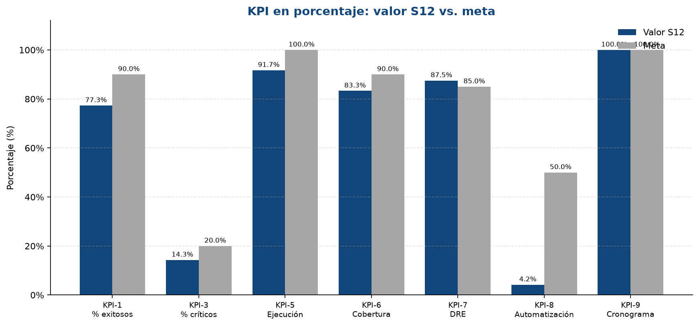
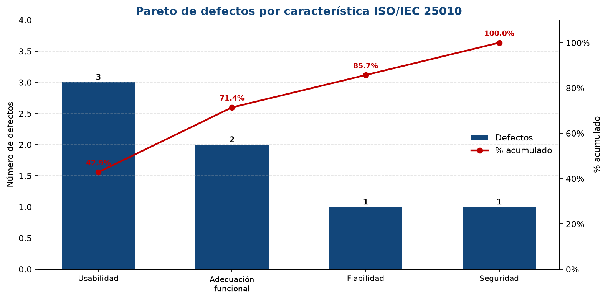

UNIVERSIDAD COOPERATIVA DE COLOMBIA
Facultad de Ingeniería
Gestión y Calidad del Software

**AVANCE 3 · APARTADO 12: Métricas de proceso y de proyecto — Tablero de KPI**

Sitio asignado: Practice Software Testing (Toolshop) — Tienda virtual de herramientas.

**Equipo 06:**
Camilo Vides
Luis Tapia
Deyner Ortiz

**Docente:** Andrea Paternina

Montería, Córdoba
2026

---

## 1. Introducción y objetivo

En el Apartado 11 medimos el **producto**: Toolshop tiene 87 puntos de función, una densidad de 0,080 defectos por PF y una complejidad ciclomática de 4 en el login y en el checkout. Esas cifras responden a *qué tan grande es el sitio* y *cuántos defectos tiene*, pero no responden dos preguntas que la docente va a hacer en la sustentación: **¿nuestro proceso de pruebas es bueno?** y **¿estamos gestionando bien el proyecto?**

Este apartado mide las otras dos dimensiones de la calidad. Las **métricas de proceso** evalúan la eficacia y la eficiencia de nuestras actividades de prueba (diseñar, ejecutar, registrar defectos, reportar). Las **métricas de proyecto** evalúan el avance del trabajo frente al plan: tiempo, esfuerzo y alcance. Con todas ellas seleccionamos un conjunto pequeño de **KPI** y armamos un **tablero de indicadores** con meta, umbrales, valor actual, estado (semáforo) y responsable.

El objetivo no es acumular números, sino **decidir**. El tablero debe decirnos qué está bien, qué está en alerta y qué acción tomar antes de la ejecución final de la Semana 15. Un tablero con 25 métricas sin metas, o solo con métricas de producto, no sirve para eso.

## 2. Marco conceptual

### 2.1 Producto, proceso y proyecto

La calidad tiene tres dimensiones que se miden distinto. El Apartado 11 cubrió la primera; este cubre las dos restantes.

| Familia | Qué mide | Para qué sirve | Ejemplos en Toolshop |
|---|---|---|---|
| Producto (S10–S11) | El software: tamaño, complejidad, defectos, desempeño. | Saber qué tan bueno es el sitio. | Densidad de defectos por PF, V(G), tiempo de carga. |
| Proceso (S12) | La eficacia y eficiencia de las actividades con que probamos. | Mejorar el método a mediano plazo. | Tasa de ejecución, cobertura, DRE. |
| Proyecto (S12) | El avance del trabajo frente al plan: tiempo, esfuerzo, alcance. | Controlar el proyecto ahora. | Cumplimiento del cronograma, desviación del esfuerzo. |

La idea de fondo es la de Deming y Humphrey: si el **proceso** es bueno y está bajo control, el producto tiende a salir bien. Por eso medir el proceso no es un trámite: es lo que permite saber si nuestras pruebas son confiables.

### 2.2 Métricas del proceso de pruebas

Nuestro proceso tiene cinco etapas: planear, diseñar casos, ejecutar, registrar defectos y reportar. Las métricas más usadas en QA, organizadas por etapa, son:

| Etapa | Métrica | Fórmula | Qué indica |
|---|---|---|---|
| Diseñar | Productividad de diseño | casos ÷ horas de diseño | Ritmo con que escribimos casos. |
| Diseñar | Cobertura funcional | funciones con casos ÷ funciones del alcance × 100 | Qué parte del sitio queda probada. |
| Ejecutar | Tasa de ejecución | ejecutados ÷ diseñados × 100 | Avance de la ejecución frente al plan. |
| Ejecutar | % de casos exitosos | exitosos ÷ ejecutados × 100 | Estabilidad del sitio en lo probado. |
| Ejecutar | % de automatización | automatizados ÷ diseñados × 100 | Madurez técnica del proceso. |
| Registrar | Tasa de detección | defectos ÷ horas de ejecución | Cuántos defectos encontramos por hora. |
| Registrar | % de reportes rechazados | rechazados ÷ reportes × 100 | Calidad de nuestros reportes (falsos positivos). |
| Reportar | Eficacia de detección (DRE) | E ÷ (E + D) × 100 | Qué proporción de los defectos atrapa nuestra suite. |

La métrica estrella es la **eficacia en la remoción de defectos (DRE)**, propuesta por Capers Jones. Se calcula con **E ÷ (E + D)**, donde **E** son los defectos que encontraron los casos planeados y **D** los que se nos escaparon y aparecieron después. En nuestro caso, **E = 7** (los defectos D-01 a D-07 del Avance 2) y **D = 1** (el defecto D-08, encontrado en una sesión exploratoria de 2 h). Por eso **DRE = 7 ÷ (7 + 1) × 100 = 87,5 %**.

El DRE no mide la calidad del sitio: **mide la calidad de nuestra suite**. Un DRE alto indica que los casos planeados atrapan casi todo; un DRE bajo indica que la matriz tiene huecos. Si D fuera 0, el DRE daría 100 %, pero eso es poco creíble para un equipo de estudiantes y no diría qué mejorar. Con D = 1 sabemos exactamente qué caso falta: la combinación **filtro + paginación**, que no estaba en la matriz.

### 2.3 Métricas de proyecto

Miden la gestión del trabajo: si cumplimos el alcance, en el tiempo y con el esfuerzo previstos.

| Métrica de proyecto | Fórmula | Qué indica |
|---|---|---|
| Cumplimiento del cronograma | avances a tiempo ÷ avances programados × 100 | Si estamos entregando a tiempo. |
| Desviación del esfuerzo | \|reales − planeadas\| ÷ planeadas × 100 | Si el trabajo cuesta más o menos de lo previsto. |
| % de alcance completado | tareas completadas ÷ tareas planeadas × 100 | Si cumplimos lo comprometido cada semana. |
| Distribución de la carga | horas de cada integrante ÷ horas totales × 100 | Si el trabajo está bien repartido. |

### 2.4 ¿Qué es un KPI?

Un **KPI** (Key Performance Indicator) es una métrica que se eligió por ser clave para un objetivo y que se compara contra una **meta** para decidir. No todas las métricas son KPI: de las 20 o 30 que podemos calcular, elegimos pocas que resuman el estado de la calidad.

| Concepto | Ejemplo en Toolshop |
|---|---|
| Métrica | Tasa de detección = 0,78 defectos por hora (dato útil, pero no se sigue cada semana). |
| KPI | % de casos exitosos = 77,3 %, meta ≥ 90 %, responsable: Integrante 1, se mide en cada ciclo. |

Un buen KPI cumple el criterio **SMART**: específico, medible, alcanzable, relevante y con tiempo definido. Además, conviene mezclar **adelantados** (leading), que anticipan el resultado y permiten corregir a tiempo (tasa de ejecución, cobertura, automatización), con **rezagados** (lagging), que muestran el resultado final (% de casos exitosos, densidad de defectos). Un tablero solo con rezagados avisa tarde.

### 2.5 El tablero de indicadores

Es una vista de **una página** que reúne los KPI con su meta, su valor actual y su estado. Se inspira en el Cuadro de Mando Integral de Kaplan y Norton: mirar el desempeño desde perspectivas balanceadas. En nuestro caso, las perspectivas son producto, proceso y proyecto. Un tablero útil tiene:

- Una fila por KPI con fórmula, meta, umbrales, valor, estado y responsable.
- Un **semáforo**: verde = cumple la meta; amarillo = alerta; rojo = no cumple.
- Una referencia de **tendencia** (se completa en la S15, con la segunda medición).
- Una o dos **gráficas** que se entiendan de un vistazo.
- Un **plan de acción** para cada KPI en amarillo o rojo: causa, acción, responsable y fecha.

## 3. Metodología

Seguimos los seis pasos del modelo: (1) reunir las métricas de producto de S10 y S11; (2) recolectar los datos de proceso y proyecto (horas, reportes, defectos escapados, automatización, entregas); (3) calcular las métricas con fórmula y valor; (4) seleccionar entre 6 y 10 KPI balanceados; (5) armar el tablero con meta, umbrales, valor, semáforo automático y una gráfica; y (6) leer el tablero y escribir el plan de acción.

## 4. Aplicación a Toolshop

### 4.1 Datos recolectados del proceso y del proyecto

**Tabla 1. Datos directos del proyecto y su fuente**

| Dato | Valor | Fuente |
|---|---|---|
| Casos diseñados | 24 | Matriz de casos (Avance 2) |
| Casos ejecutados | 22 | Registro de ejecución |
| Casos exitosos | 17 | Registro de ejecución |
| Defectos detectados (E) | 7 | Registro de defectos (D-01 a D-07) |
| Funciones del alcance | 12 | Avance 1 y Avance 2 |
| Funciones cubiertas | 10 | Matriz de casos |
| Puntos de función (PF) | 87,22 | Apartado 11 (PFNA 89 × VAF 0,98) |
| Tiempo de carga del catálogo | 2,4 s | Medición con DevTools |
| Casos con script automatizado | 1 | Repositorio de scripts (login, S11) |
| Horas de diseño de casos | 13 h | Registro de horas del equipo |
| Horas de ejecución | 9 h | Registro de horas del equipo |
| Horas de sesión exploratoria | 2 h | Registro de horas del equipo |
| Horas de documentación y revisión | 28 h | Registro de horas del equipo |
| Horas planeadas del Avance 2 | 48 h | Avance 2, Tabla 21 |
| Reportes de defecto totales | 8 | Registro de defectos |
| Reportes rechazados | 1 | Registro de defectos (no reproducible) |
| Defectos escapados (D) | 1 | Sesión exploratoria (D-08) |
| Defectos críticos | 1 | Registro de defectos (D-06) |
| Avances entregados a tiempo | 2 de 2 | Aula Extendida |
| Horas por integrante | 18 / 17 / 17 h | Registro de horas del equipo |

Los dos casos que no se ejecutaron fueron **CP-14 (filtros combinados)** y **CP-24 (checkout con producto agotado)**. Las dos funciones sin casos son **registro de usuario** y **recuperación de contraseña**. El defecto escapado **D-08** apareció en la sesión exploratoria: al aplicar un filtro y pasar a la página 2 del catálogo, el filtro se pierde y aparecen productos de otras categorías.

### 4.2 Métricas de producto, proceso y proyecto calculadas

**Tabla 2. Métricas de producto (base S10–S11)**

| Métrica | Fórmula | Cálculo | Valor |
|---|---|---|---|
| Densidad de defectos por PF | defectos ÷ PF | 7 ÷ 87,22 | **0,080** |
| % de defectos críticos | críticos ÷ defectos × 100 | 1 ÷ 7 × 100 | **14,3 %** |
| Tiempo de carga del catálogo | medición directa | — | **2,4 s** |
| % de casos exitosos | exitosos ÷ ejecutados × 100 | 17 ÷ 22 × 100 | **77,3 %** |

**Tabla 3. Métricas de proceso**

| Métrica | Fórmula | Cálculo | Valor |
|---|---|---|---|
| Productividad de diseño | casos ÷ horas de diseño | 24 ÷ 13 | **1,85 casos/h** |
| Tasa de ejecución | ejecutados ÷ diseñados × 100 | 22 ÷ 24 × 100 | **91,7 %** |
| Cobertura funcional | cubiertas ÷ alcance × 100 | 10 ÷ 12 × 100 | **83,3 %** |
| % de automatización | automatizados ÷ diseñados × 100 | 1 ÷ 24 × 100 | **4,2 %** |
| Tasa de detección | defectos ÷ horas de ejecución | 7 ÷ 9 | **0,78 def./h** |
| % de reportes rechazados | rechazados ÷ reportes × 100 | 1 ÷ 8 × 100 | **12,5 %** |
| Eficacia de detección (DRE) | E ÷ (E + D) × 100 | 7 ÷ (7 + 1) × 100 | **87,5 %** |

**Tabla 4. Métricas de proyecto**

| Métrica | Fórmula | Cálculo | Valor |
|---|---|---|---|
| Cumplimiento del cronograma | a tiempo ÷ programados × 100 | 2 ÷ 2 × 100 | **100 %** |
| Desviación del esfuerzo | \|reales − planeadas\| ÷ planeadas × 100 | \|52 − 48\| ÷ 48 × 100 | **8,3 %** |
| Distribución de la carga | horas integrante ÷ horas totales × 100 | 18/17/17 ÷ 52 | **34,6 % / 32,7 % / 32,7 %** |

### 4.3 Selección de los KPI

De todas las métricas anteriores elegimos **10 KPI**, balanceados entre las tres dimensiones: 4 de producto, 4 de proceso y 2 de proyecto. Cuatro son adelantados.

**Tabla 5. Selección de los 10 KPI**

| KPI | Nombre | Dimensión / característica | Tipo | ¿Por qué es clave? |
|---|---|---|---|---|
| KPI-1 | % de casos exitosos | Producto · Adecuación funcional | Rezagado | Resume si el flujo de compra funciona. |
| KPI-2 | Densidad de defectos por PF | Producto · Fiabilidad | Rezagado | Normaliza los defectos con el tamaño (S11). |
| KPI-3 | % de defectos críticos | Producto · Fiabilidad | Rezagado | Un defecto crítico pesa más que varios leves. |
| KPI-4 | Tiempo de carga del catálogo | Producto · Eficiencia de desempeño | Rezagado | Característica priorizada en la S8. |
| KPI-5 | Tasa de ejecución | Proceso · completar la matriz | Adelantado | Avisa si no alcanzaremos a probar todo. |
| KPI-6 | Cobertura funcional | Proceso · probar todo el alcance | Adelantado | Avisa qué parte del sitio queda sin probar. |
| KPI-7 | Eficacia de detección (DRE) | Proceso · eficacia de la suite | Rezagado | Mide si nuestros casos atrapan los defectos. |
| KPI-8 | % de automatización | Proceso · madurez técnica | Adelantado | Prepara la ejecución automatizada de la S15. |
| KPI-9 | Cumplimiento del cronograma | Proyecto · gestión del tiempo | Rezagado | Las entregas están encadenadas en el Aula. |
| KPI-10 | Desviación del esfuerzo | Proyecto · gestión de horas | Adelantado | Avisa si el trabajo cuesta más de lo previsto. |

Quedaron como **métricas de apoyo (no KPI)**: productividad de diseño, tasa de detección, % de reportes rechazados y distribución de la carga. Se calculan y se reportan, pero no se siguen en el tablero porque no cambian la decisión semana a semana.

### 4.4 Ficha completa de un KPI

**Tabla 6. Ficha del KPI-8 · % de automatización**

| Campo | KPI-8 · % de automatización |
|---|---|
| Dimensión y característica | Proceso · objetivo del plan: preparar la ejecución automatizada de la S15. |
| Objetivo | Que al cierre de la S15 al menos la mitad de los casos diseñados tengan un script automatizado. |
| Fórmula y fuente | casos con script ÷ casos diseñados × 100. Fuente: repositorio de scripts y matriz de casos. |
| Meta | ≥ 50 % al cierre de la S15. |
| Umbrales | Verde ≥ 50 % · Amarillo 30 – 49,9 % · Rojo < 30 %. |
| Tipo | Adelantado. |
| Frecuencia y responsable | Cada ciclo de automatización (S13–S15) · Integrante 3. |
| Valor actual | **4,2 % → Rojo.** |

### 4.5 Tablero de KPI (línea base S12)

**Tabla 7. Tablero de indicadores de Toolshop**

| KPI | Meta | Amarillo | Rojo | Valor S12 | Estado | Responsable |
|---|---|---|---|---|---|---|
| KPI-1 % casos exitosos | ≥ 90 % | 75 – 89,9 % | < 75 % | 77,3 % | **Amarillo** | Integrante 1 |
| KPI-2 Defectos por PF | ≤ 0,08 | 0,081 – 0,12 | > 0,12 | 0,080 | **Verde** | Integrante 1 |
| KPI-3 % defectos críticos | ≤ 20 % | 20,1 – 30 % | > 30 % | 14,3 % | **Verde** | Integrante 1 |
| KPI-4 Tiempo de catálogo | ≤ 3 s | 3,1 – 4 s | > 4 s | 2,4 s | **Verde** | Integrante 2 |
| KPI-5 Tasa de ejecución | 100 % | 80 – 99,9 % | < 80 % | 91,7 % | **Amarillo** | Integrante 2 |
| KPI-6 Cobertura funcional | ≥ 90 % | 75 – 89,9 % | < 75 % | 83,3 % | **Amarillo** | Integrante 2 |
| KPI-7 Eficacia de detección | ≥ 85 % | 70 – 84,9 % | < 70 % | 87,5 % | **Verde** | Integrante 2 |
| KPI-8 % automatización | ≥ 50 % | 30 – 49,9 % | < 30 % | 4,2 % | **Rojo** | Integrante 3 |
| KPI-9 Cumplimiento cronograma | 100 % | 80 – 99,9 % | < 80 % | 100 % | **Verde** | Integrante 3 |
| KPI-10 Desviación del esfuerzo | ≤ 10 % | 10,1 – 20 % | > 20 % | 8,3 % | **Verde** | Integrante 3 |

**Resumen: 6 KPI en verde, 3 en amarillo y 1 en rojo.**

<em>Figura 1. KPI en porcentaje: valor S12 vs. meta (elaboración propia).</em>

El tablero completo, con las fórmulas del semáforo, la gráfica de KPI contra la meta y el Pareto, está en el archivo **`GCS_Equipo06_Apartado12_Tablero_KPI_Toolshop.xlsx`**. Cada valor se calcula con una fórmula que apunta a la hoja «Datos», de modo que al actualizar los datos en la S15 el semáforo se recalcula solo.

### 4.6 Lectura integrada del tablero y plan de acción

El tablero cuenta una historia coherente. **El proceso detecta bien los defectos** (KPI-7, DRE de 87,5 %, verde): de los 8 defectos conocidos, 7 los atraparon los casos planeados y solo 1 se escapó. Por eso el **producto** aparece en alerta (KPI-1, 77,3 % de casos exitosos, amarillo), pero no porque probemos mal: el sitio tiene defectos deliberados. La densidad de 0,080 defectos/PF (KPI-2) y el 14,3 % de defectos críticos (KPI-3) están en verde, lo que indica que el tamaño del producto y la gravedad de lo encontrado son manejables.

Las alertas de **proceso** son de cobertura, no de calidad del sitio: la tasa de ejecución es 91,7 % (KPI-5) porque quedaron sin ejecutar CP-14 y CP-24, y la cobertura es 83,3 % (KPI-6) porque registro y recuperación de contraseña no tienen casos. El único **rojo** es la automatización (KPI-8, 4,2 %): solo el login tiene script, y sin automatización la ejecución de la S15 no alcanza a cubrir los 16 casos automatizables.

En **proyecto** entregamos a tiempo (KPI-9, 100 %, verde) y con una desviación de horas de 8,3 % (KPI-10, verde, dentro del ±10 %), así que el plan es realista. El riesgo no es el tiempo: es la automatización.

**Tabla 8. Pareto de defectos por característica ISO/IEC 25010**

| Característica | Defectos | % del total | % acumulado |
|---|---|---|---|
| Usabilidad | 3 | 42,9 % | 42,9 % |
| Adecuación funcional | 2 | 28,6 % | 71,4 % |
| Fiabilidad | 1 | 14,3 % | 85,7 % |
| Seguridad | 1 | 14,3 % | 100,0 % |
| **Total** | **7** | **100 %** | — |

*Nota.* Porcentajes redondeados a un decimal; la columna acumulada se calcula sobre los 7 defectos exactos.

<em>Figura 2. Pareto de defectos por característica ISO/IEC 25010 (elaboración propia).</em>

El Pareto muestra que **usabilidad y adecuación funcional concentran el 71,4 % de los defectos**. Ahí deben concentrarse las nuevas pruebas y la automatización, no en las características que ya están verdes.

**Tabla 9. Plan de acción para los KPI en amarillo y rojo**

| KPI en alerta | Causa probable | Acción | Responsable | Fecha |
|---|---|---|---|---|
| KPI-8 % automatización (rojo) | Solo el login tiene script; la automatización no arrancó. | Automatizar login y filtros en S13, y carrito y checkout en S14. Meta: 8 casos (33 %) en S14 y 12 casos (50 %) en S15. | Integrante 3 | S13–S15 |
| KPI-5 Tasa de ejecución (amarillo) | Quedaron CP-14 y CP-24 sin ejecutar. | Ejecutar ambos casos y registrar la evidencia. | Integrante 2 | S13 |
| KPI-6 Cobertura funcional (amarillo) | Registro y recuperación no tienen casos; falta filtro + paginación (D-08). | Diseñar CP-25 (filtro + paginación), CP-26 (registro) y CP-27 (recuperación de contraseña). | Integrante 2 | S13 |
| KPI-1 y KPI-2 (producto) | Defectos del sitio, concentrados en usabilidad y adecuación funcional. | No se corrige el sitio: documentar cada defecto con evidencia y severidad, y priorizar esas características en la nueva matriz. | Integrante 1 | S13–S15 |
| KPI-10 Desviación del esfuerzo (verde, pero vigilado) | Subestimación leve de las horas de diseño. | Ajustar la estimación de S13–S15 en +5 – 10 %. | Integrante 3 | S13 |

### 4.7 Enlace con lo que ya hicimos y lo que viene

El tablero integra el semestre. Del **Apartado 11** toma los 87 PF y la densidad de 0,080 defectos/PF (KPI-2), y la V(G) = 4 del login y del checkout, que fija el mínimo de 4 casos por flujo. De la **S10** toma los casos, los defectos y los tiempos. De la **S9** toma las tres dimensiones (producto, proceso y proyecto) y el balance del tablero.

Lo que sigue: las acciones de la Tabla 9 entran al **diseño de casos por niveles y tipos de la S13** (CP-25, CP-26, CP-27 y la ejecución de CP-14 y CP-24); los criterios de aceptación de la **S14** se fijan con estas metas; y en la **S15** actualizamos el tablero con los datos reales de la ejecución, agregamos la columna de tendencia y verificamos si la automatización llegó al 50 %.

### 4.8 Conclusión

Para controlar la calidad de nuestro proyecto sobre Toolshop definimos métricas de proceso (tasa de ejecución, cobertura, DRE, automatización) y de proyecto (cumplimiento del cronograma y desviación del esfuerzo), y seleccionamos **10 KPI balanceados** entre producto, proceso y proyecto, cada uno con fórmula, meta, umbrales y responsable. La línea base del tablero muestra **6 KPI en verde, 3 en amarillo y 1 en rojo**: nuestro proceso detecta bien los defectos (DRE = 87,5 %), lo que explica que la calidad del producto aparezca en alerta (77,3 % de casos exitosos), concentrada en usabilidad y adecuación funcional (71,4 % del Pareto). El principal riesgo es la baja automatización (4,2 %), para la cual definimos un plan de acción en S13–S15. Este tablero será nuestra herramienta de control hasta la ejecución final.

## 5. Relación con ISO/IEC 25010 y con la madurez del proceso

- **Adecuación funcional y fiabilidad:** KPI-1, KPI-2 y KPI-3 traducen los defectos del Avance 2 a indicadores con meta; el Pareto los enfoca en las características que más fallan.
- **Eficiencia de desempeño:** KPI-4 convierte el tiempo de carga del catálogo (2,4 s) en un indicador con umbral, tal como se priorizó en la S8.
- **Proceso de pruebas:** KPI-5, KPI-6, KPI-7 y KPI-8 miden la eficacia y la madurez de nuestro proceso, no del sitio. Es el paso que pide el **Nivel 4 de CMMI/SPICE** (proceso cuantitativamente gestionado), que en la S7 quedó como horizonte del equipo.
- **Proyecto:** KPI-9 y KPI-10 controlan tiempo y esfuerzo, las dos restricciones que en el Avance 2 limitaron la ronda piloto a 24 casos.

## 6. Conclusiones

- Las métricas de proceso y de proyecto completan lo que las métricas de producto no podían responder: si nuestro método de prueba es confiable y si el proyecto va según el plan.
- El DRE de 87,5 % indica que la suite atrapa 7 de cada 8 defectos conocidos; el defecto escapado D-08 señala un hueco concreto (filtro + paginación) que se corrige en la S13.
- El tablero es **balanceado y pequeño** (10 KPI: 4 de producto, 4 de proceso y 2 de proyecto), y cada KPI tiene fórmula, meta, umbrales, valor y responsable.
- El único rojo es la automatización (4,2 %). Es el riesgo principal para la S15 y el plan de acción ya tiene responsables y fechas.
- El tablero queda en Excel con fórmulas y gráficas, listo para actualizarse en la S15 sin rehacer los cálculos.

## Referencias

Doran, G. T. (1981). There's a S.M.A.R.T. way to write management's goals and objectives. *Management Review, 70*(11), 35–36.

ISO/IEC. (2011). *ISO/IEC 25010:2011 — Systems and software engineering — SQuaRE — System and software quality models*. ISO.

ISO/IEC/IEEE. (2017). *ISO/IEC/IEEE 15939:2017 — Systems and software engineering — Measurement process*. ISO/IEC/IEEE.

ISTQB. (2023). *Certified Tester Foundation Level Syllabus* (v4.0). International Software Testing Qualifications Board.

Jones, C. (2008). *Applied Software Measurement: Global Analysis of Productivity and Quality* (3.ª ed.). McGraw-Hill.

Kan, S. H. (2002). *Metrics and Models in Software Quality Engineering* (2.ª ed.). Addison-Wesley.

Kaplan, R. S., & Norton, D. P. (1996). *The Balanced Scorecard: Translating Strategy into Action*. Harvard Business School Press.

Parmenter, D. (2015). *Key Performance Indicators: Developing, Implementing, and Using Winning KPIs* (3.ª ed.). Wiley.

Pressman, R. S., & Maxim, B. R. (2020). *Software Engineering: A Practitioner's Approach* (9.ª ed.). McGraw-Hill.

Project Management Institute. (2021). *A Guide to the Project Management Body of Knowledge (PMBOK Guide)* (7.ª ed.). PMI.
