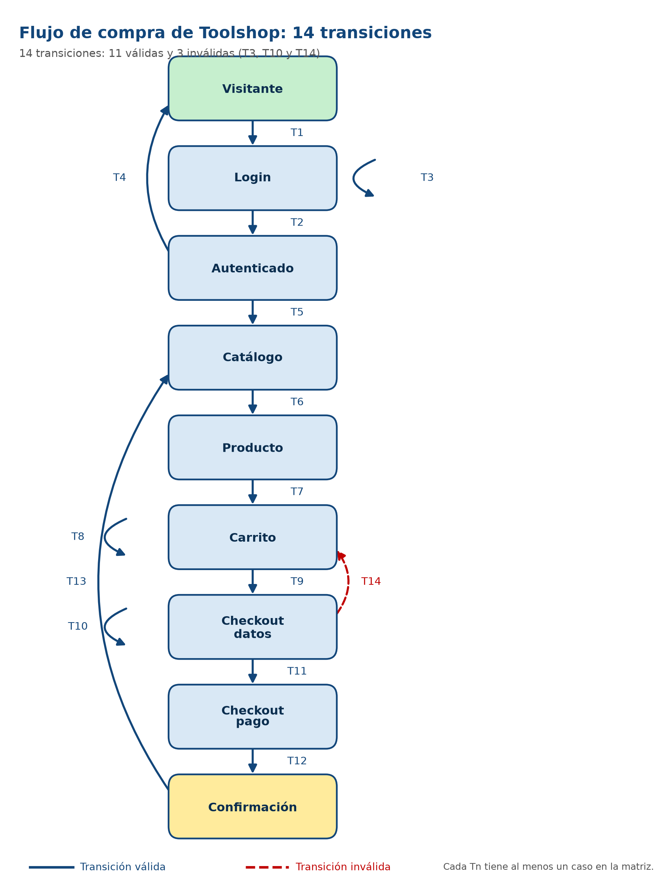
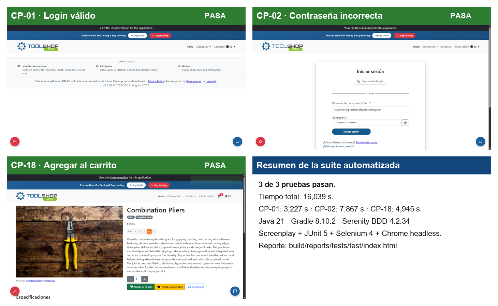
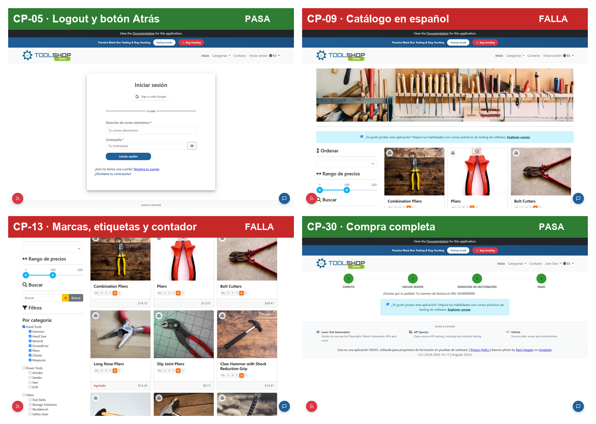
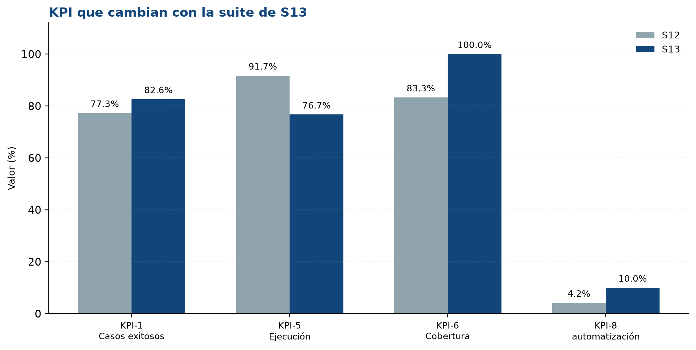
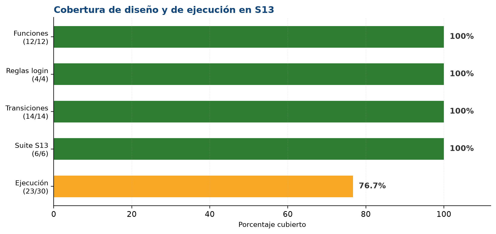
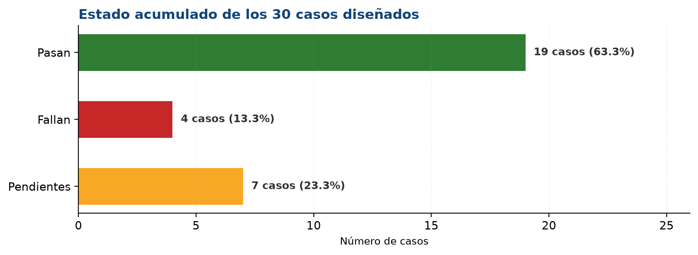

<div class="cover">

<p class="cover-universidad">UNIVERSIDAD COOPERATIVA DE COLOMBIA</p>
<p class="cover-facultad">Facultad de Ingeniería · Programa Ingeniería de Software</p>
<p class="cover-curso">Gestión y Calidad del Software · 2026-2</p>

<h1>Apartado 13</h1>
<h2>Pruebas de software: niveles, tipos y técnicas aplicadas a Toolshop</h2>

<p class="cover-sub">Diseño de una suite de 30 casos, ejecución de 6 pruebas (3 manuales y 3 automatizadas) y actualización de los KPI</p>

<hr />

<p><strong>Equipo 06</strong></p>
<p>Camilo Vides · Luis Tapia · Deyner Ortiz</p>
<p>Docente: Andrea Paternina</p>
<p>Avance 3 · Semana 13 · Noviembre de 2026</p>
<p>Sitio asignado: Toolshop — https://practicesoftwaretesting.com</p>

</div>

<div class="pagebreak"></div>

## Resumen

Este apartado cierra el diseño de la suite de pruebas de Toolshop y deja una primera ejecución de la semana 13. Partimos de los 24 casos del Avance 2, revisamos el tablero de la S12 y diseñamos **30 casos**: los 24 anteriores más 6 nuevos que cubren los huecos de registro, recuperación de contraseña, filtros con paginación y checkout. Cada caso tiene técnica, nivel, tipo, prioridad, datos y resultado esperado; la matriz completa está en el archivo Excel que acompaña este documento.

La suite quedó completa en diseño: **12 de 12 funciones**, **4 de 4 reglas del login** y **14 de 14 transiciones** tienen al menos un caso. De los 30 casos, **22 son candidatos a automatizar** y **8 se quedan manuales**. Para la ejecución de S13 escogimos 6: **3 automatizados** (CP-01, CP-02 y CP-18) y **3 manuales** (CP-05, CP-09 y CP-13). El resultado fue **4 pasan y 2 fallan**. Además ejecutamos CP-30 como prueba exploratoria de compra completa: pasó y generó la factura **INV-2026000008**.

Con la nueva matriz, el **KPI-6 de cobertura funcional sube a 100 %** y pasa a verde; el **KPI-5 de ejecución baja a 76,7 %** porque el denominador creció de 24 a 30 casos; y el **KPI-8 de automatización sube a 10 %**, pero sigue en rojo frente a la meta de 50 %. Las dos fallas manuales son de idioma: el catálogo y los filtros mezclan español con inglés. D-01 (logout con el botón Atrás) y D-03 (marcas de prueba) no se reprodujeron en la versión actual; D-02 y D-04 siguen abiertos.

<div class="pagebreak"></div>

## Contenido

1. Introducción
2. Marco conceptual: niveles, tipos y técnicas
3. Contexto y alcance del sitio
4. Diseño de la suite de pruebas
5. Ejecución de la S13
6. Cobertura y actualización de los KPI
7. Enlace con la S12, la S14 y la S15
8. Conclusiones
9. Referencias
Anexos

*Nota: las tablas y figuras de este documento son de elaboración propia a partir de la matriz y de las ejecuciones de S13. Las fuentes externas se citan en el texto y se detallan en la sección 9.*

<div class="pagebreak"></div>

## 1. Introducción

En la S11 medimos el producto: Toolshop tiene **87,22 puntos de función** y el login exige un mínimo de **4 caminos independientes** porque su complejidad ciclomática es **V(G) = 4** (McCabe, 1976). En la S12 medimos el proceso y el proyecto, y el tablero nos dejó tres alertas: la cobertura funcional estaba en **83,3 %**, la tasa de ejecución en **91,7 %** y la automatización en **4,2 %**. El plan de acción de esa semana pidió diseñar los casos que faltaban, ejecutar los pendientes y empezar a automatizar.

Este apartado convierte ese plan en una suite concreta. No escribimos casos “a ojo”: cada uno sale de una técnica de diseño y se puede rastrear hasta una función del sitio y una característica de ISO/IEC 25010 (ISO/IEC, 2011). La pregunta que guía el trabajo es sencilla: **¿qué casos necesitamos para cubrir todo el alcance con el menor número razonable de pruebas, y cuáles de esos casos se pueden automatizar?**

La respuesta tiene tres partes. Primero, un mapa de las 12 funciones con su nivel, sus tipos de prueba y las técnicas que aplican. Segundo, una matriz de **30 casos** con datos concretos y resultados esperados verificables. Tercero, una ejecución de **6 pruebas** —3 manuales y 3 automatizadas— con evidencia, más una compra completa exploratoria que sirve como prueba de aceptación.

El documento también es honesto con lo que no alcanzó a hacerse. CP-14 y CP-24 siguen pendientes; los casos nuevos CP-25 a CP-29 están diseñados pero no ejecutados; y la automatización llegó a 3 casos, no a la meta de 50 %. Esos pendientes son, precisamente, la entrada de la S14 y la S15.

## 2. Marco conceptual: niveles, tipos y técnicas

### 2.1 Niveles de prueba

Los niveles indican **qué parte del sistema** se prueba y en qué momento del desarrollo. El modelo en V de la S5 los relaciona con los productos del lado izquierdo: requisitos, diseño, código y sistema (Sommerville, 2016). Para Toolshop, que es un sitio ya construido y sin acceso al repositorio, el nivel principal es **sistema**; la compra completa la tratamos como **aceptación**.

| Nivel | Qué se prueba | ¿Aplica en Toolshop? |
|---|---|---|
| Unitario | Una función o clase aislada | No directamente: no tenemos el código fuente del sitio. |
| Integración | La comunicación entre componentes | Parcial: la vemos desde la interfaz, por ejemplo carrito y checkout. |
| Sistema | El sitio completo contra sus requisitos funcionales y no funcionales | Sí: es nuestro nivel principal. |
| Aceptación | El flujo de negocio de principio a fin | Sí: CP-30, compra completa. |

No simulamos pruebas unitarias que no podemos hacer. Decir que “probamos el código” sin tener el repositorio sería inflar el alcance. Lo que sí hicimos fue probar el sistema real, con la interfaz y los datos que un cliente usaría.

### 2.2 Tipos de prueba

Los tipos indican **qué objetivo** tiene la prueba. Un mismo nivel de sistema puede incluir pruebas funcionales, de seguridad, de usabilidad, de desempeño o de fiabilidad. En la matriz usamos estos tipos, todos relacionados con ISO/IEC 25010:

| Tipo | Objetivo | Ejemplo en Toolshop |
|---|---|---|
| Funcional | Verificar que una función haga lo que debe | Login válido, agregar al carrito, comprar. |
| Seguridad | Verificar control de acceso y protección | Entrar a `/account` sin sesión; logout y botón Atrás. |
| Usabilidad | Verificar claridad, consistencia y mensajes | Catálogo en español; etiquetas de filtros; campos obligatorios. |
| Desempeño | Verificar tiempos de respuesta | Carga del catálogo: 2,4 s (KPI-4 de la S12). |
| Fiabilidad | Verificar que el sistema conserve su estado | Recargar la página con productos en el carrito. |
| Regresión | Verificar que lo que funcionaba siga funcionando | Suite de regresión con un caso por función. |

La prueba de regresión no es un tipo distinto de objetivo, sino una forma de repetir lo que ya funcionaba después de un cambio. En S13 la dejamos definida como suite, aunque todavía no la ejecutamos completa.

### 2.3 Técnicas de diseño

Las técnicas de diseño son métodos para **elegir** qué casos escribir. No prueban todo lo posible —eso es imposible—, pero eligen valores representativos (ISTQB, 2023). Usamos seis familias:

| Familia | Técnica | Cuándo la usamos | Ejemplo en Toolshop |
|---|---|---|---|
| Caja negra | Partición de equivalencia (PE) | Cuando muchos valores se comportan igual | Correo válido, vacío o con credenciales inválidas. |
| Caja negra | Valores límite (AVL) | Cuando hay mínimos, máximos o longitudes | Cantidad 0, 1, 2, 99 y 100; dirección de 0, 1 y longitud normal. |
| Caja negra | Tabla de decisión (TD) | Cuando el resultado depende de varias condiciones | Login: correo vacío, contraseña vacía, credenciales válidas. |
| Caja negra | Transición de estados (TE) | Cuando el sistema cambia de estado según eventos | Carrito -> checkout -> pago -> confirmación. |
| Caja negra | Casos de uso / escenarios | Cuando se prueba un proceso completo | Compra de principio a fin; recuperación de contraseña. |
| Experiencia | Adivinación de errores y exploratoria | Cuando hay historial de defectos o poca documentación | Filtros, paginación, botón Atrás, recarga del carrito. |

También usamos **listas de comprobación** para lo visual y lo consistente: idioma, etiquetas, mensajes de error y estados vacíos. No es una técnica formal de caja negra, pero ayuda a no dejar pasar defectos de usabilidad que un caso funcional no ve.

### 2.4 Principios que aplicamos

Tomamos cuatro principios de ISTQB (2023) que explican nuestras decisiones:

1. **La prueba exhaustiva es imposible.** No podemos probar todos los correos, todas las direcciones ni todos los productos. Por eso usamos clases y límites.
2. **Probar temprano ahorra tiempo.** Diseñar los casos antes de ejecutar nos permitió ver que faltaban registro y recuperación, y que el login necesitaba separar los campos vacíos.
3. **La paradoja del pesticida.** Repetir solo los mismos casos deja de encontrar defectos. Por eso agregamos CP-25 (filtros con paginación) y CP-30 (compra completa).
4. **Los defectos se agrupan.** En la S12, usabilidad y adecuación funcional concentraban el 71,4 % de los defectos. Por eso la nueva matriz refuerza esas zonas.

## 3. Contexto y alcance del sitio

Toolshop es una tienda virtual de demostración para practicar pruebas. El sitio reporta la versión **v5.0** y en el pie muestra **v2.5 | Built 2026-10-11 | Angular 20.0.5**. La cuenta que usamos es `customer@practicesoftwaretesting.com` con contraseña `welcome01`. La interfaz arranca en español, pero conserva varios textos en inglés; eso se convirtió, sin proponérnoslo, en uno de los hallazgos de la semana.

El alcance funcional es el mismo de la S11 y la S12: **12 funciones**. En la S12, 10 tenían al menos un caso; las dos que faltaban eran **registro de usuario** y **recuperación de contraseña**. La matriz de S13 las incorpora, y además agrega filtros con paginación y checkout con dirección corta.

| Función | Qué hace | Cobertura S12 | Casos S13 |
|---|---|---|---|
| F1 · Iniciar sesión | Autentica al cliente | Sí | CP-01 a CP-04 |
| F2 · Cerrar sesión | Termina la sesión | Sí | CP-05 |
| F3 · Registro de usuario | Crea una cuenta nueva | No | CP-26, CP-27 |
| F4 · Recuperación de contraseña | Envía el enlace de recuperación | No | CP-28 |
| F5 · Listado de catálogo | Muestra productos y disponibilidad | Sí | CP-06, CP-07, CP-09 |
| F6 · Ordenamiento | Ordena por nombre o precio | Sí | CP-08 |
| F7 · Filtro por categoría | Filtra por categoría | Sí | CP-10, CP-14, CP-25 |
| F8 · Filtro por marca | Filtra por marca | Sí | CP-11, CP-13, CP-14 |
| F9 · Filtro por precio | Filtra por rango | Sí | CP-12, CP-13, CP-14, CP-25 |
| F10 · Ficha de producto | Muestra el detalle | Sí | CP-15, CP-16, CP-17 |
| F11 · Carrito | Agrega, cambia y elimina productos | Sí | CP-17 a CP-21 |
| F12 · Checkout | Completa la compra | Sí | CP-22 a CP-24, CP-29, CP-30 |

La línea base de la S12 era: **24 casos diseñados, 22 ejecutados, 17 exitosos, 7 defectos, DRE 87,5 % y un defecto escapado D-08**. Esa línea base es la que actualizamos al final de este documento.

<div class="pagebreak"></div>

## 4. Diseño de la suite de pruebas

### 4.1 Mapa de pruebas: funciones, niveles, tipos y técnicas

El mapa es el punto de partida. Para cada función definimos el nivel, los tipos de prueba y las técnicas que tenían sentido. No todas las funciones necesitan todos los tipos; por ejemplo, el ordenamiento es funcional, mientras que el logout tiene un componente de seguridad.

| Función | Nivel | Tipos de prueba | Técnicas aplicadas |
|---|---|---|---|
| F1 · Iniciar sesión | Sistema | Funcional, seguridad | Tabla de decisión, PE, TE, camino básico (S11) |
| F2 · Cerrar sesión | Sistema | Funcional, seguridad | TE, adivinación de errores |
| F3 · Registro de usuario | Sistema | Funcional, seguridad | PE, AVL |
| F4 · Recuperación de contraseña | Sistema | Funcional, seguridad | Caso de uso, PE |
| F5 · Listado de catálogo | Sistema | Funcional, usabilidad, desempeño | Escenario, checklist, adivinación, medición |
| F6 · Ordenamiento | Sistema | Funcional | PE (4 criterios de orden) |
| F7 · Filtro por categoría | Sistema | Funcional | PE, TE |
| F8 · Filtro por marca | Sistema | Funcional, usabilidad | PE, checklist |
| F9 · Filtro por rango de precio | Sistema | Funcional | PE, AVL |
| F10 · Ficha de producto | Sistema | Funcional, usabilidad | Escenario, PE |
| F11 · Carrito | Sistema / integración (vista de usuario) | Funcional, fiabilidad | AVL, TE, adivinación |
| F12 · Checkout | Sistema / aceptación | Funcional, usabilidad | PE, AVL, TE, caso de uso |

La función F5 incluye una medición de desempeño porque el KPI-4 de la S12 ya medía la carga del catálogo. No agregamos un caso separado de performance para no inflar la matriz; el dato de 2,4 s queda asociado a CP-06.

### 4.2 Partición de equivalencia y valores límite

La partición de equivalencia agrupa valores que el sistema trata igual. Los valores límite prueban justo el borde de cada clase, porque ahí suelen aparecer los errores. En Toolshop aplicamos ambas a cuatro entradas:

| Entrada | Técnica | Clases / rangos | Valores usados | Casos |
|---|---|---|---|---|
| Correo de login | PE | Válido registrado / vacío / credenciales inválidas | `customer@practicesoftwaretesting.com`; cadena vacía; mismo correo con clave incorrecta | CP-01, CP-02, CP-03 |
| Contraseña de login | PE y AVL | Válida / vacía / incorrecta | `welcome01`; cadena vacía; `clave_incorrecta_123` | CP-01, CP-02, CP-03 |
| Cantidad en ficha de producto | AVL | 1 (mínimo), 2, 99 (máximo), 100 (fuera) | 0, 1, 2, 99, 100 | CP-18, CP-19 |
| Dirección de facturación | AVL | 0, 1 y longitud normal | cadena vacía; `A`; `Calle 1 # 2-3` | CP-23, CP-29, CP-30 |

El caso CP-03 cubre dos campos vacíos en una sola ejecución. La S11 ya había recomendado separarlo en dos casos atómicos; en S15 lo vamos a dividir para que el resultado de cada mensaje quede explícito. Por eso la matriz lo deja como un caso heredado y no como dos nuevos.

### 4.3 Tabla de decisión del login

El login depende de tres condiciones: correo vacío, contraseña vacía y credenciales válidas. La tabla de decisión produce cuatro reglas y cada regla es un caso. El guion “–” significa que esa condición no importa en esa regla.

| Regla | ¿Correo vacío? | ¿Contraseña vacía? | ¿Credenciales válidas? | Resultado esperado | Caso |
|---|---|---|---|---|---|
| R1 | Sí | – | – | `El correo electrónico es obligatorio` | CP-03 (ejecución A) |
| R2 | No | Sí | – | `La contraseña es obligatoria` | CP-03 (ejecución B) |
| R3 | No | No | No | `Invalid email or password` | CP-02 |
| R4 | No | No | Sí | URL `/account` | CP-01 |

Las cuatro reglas coinciden con los **4 caminos independientes** que calculamos con la complejidad ciclomática en la S11. Que dos técnicas distintas lleguen al mismo número es una buena señal: la suite del login está completa para el flujo observado. La regla R3 también muestra un detalle de idioma: el mensaje de credenciales inválidas está en inglés aunque el resto del formulario esté en español.

### 4.4 Transición de estados del flujo de compra

El flujo de compra pasa por varios estados. La figura muestra el camino principal, los retornos y las transiciones inválidas. Las transiciones válidas van en azul; las inválidas o de error van en rojo discontinuo.

<p style="text-align:center;"></p>
<p class="caption"><em>Figura 1. Diagrama de transición de estados del flujo de compra de Toolshop (elaboración propia).</em></p>

El criterio de cobertura es que **todas** las transiciones tengan al menos un caso. La tabla las relaciona:

| Transición | Estados | Evento | Caso | Tipo |
|---|---|---|---|---|
| T1 | Visitante -> Login | Abrir login o acceso directo sin sesión | CP-04 | Válida |
| T2 | Login -> Autenticado | Credenciales válidas | CP-01 | Válida |
| T3 | Login -> Login | Credenciales inválidas o campos vacíos | CP-02, CP-03 | Inválida |
| T4 | Autenticado -> Visitante | Cerrar sesión | CP-05 | Válida |
| T5 | Autenticado -> Catálogo | Abrir catálogo | CP-06 | Válida |
| T6 | Catálogo -> Producto | Abrir ficha de producto | CP-15 | Válida |
| T7 | Producto -> Carrito | Agregar al carrito | CP-18 | Válida |
| T8 | Carrito -> Carrito | Modificar cantidad o eliminar | CP-19, CP-20 | Válida |
| T9 | Carrito -> Checkout datos | Iniciar checkout | CP-22 | Válida |
| T10 | Checkout datos -> Checkout datos | Datos inválidos | CP-23, CP-29 | Inválida |
| T11 | Checkout datos -> Checkout pago | Datos válidos | CP-30 | Válida |
| T12 | Checkout pago -> Confirmación | Pago confirmado | CP-30 | Válida |
| T13 | Confirmación -> Catálogo | Volver a comprar | CP-30 | Válida |
| T14 | Checkout datos -> Carrito | Producto agotado | CP-24 | Inválida |

Hay **11 transiciones válidas y 3 inválidas**. La cobertura es **14 de 14 = 100 %**. La transición T1 se cubre con CP-04, que intenta abrir `/account` sin sesión y confirma que el sitio redirige al login. La T14 se cubre con CP-24, que todavía está pendiente de ejecutar; por eso la cobertura es de diseño, no de ejecución.

### 4.5 Caso de uso: comprar un producto de principio a fin

El flujo principal de compra es el siguiente: el cliente inicia sesión, abre la ficha de **Combination Pliers**, la agrega al carrito, entra al checkout, escribe sus datos, elige el pago y confirma. En la ejecución exploratoria de S13 el sitio generó la factura **INV-2026000008** y mostró un total de **$14.15** por una unidad. Ese valor es la salida externa que la S11 contó como EO-1: no basta con que la compra “termine”, hay que verificar que el total sea coherente.

**Flujo principal (CP-30):**

1. Abrir `https://practicesoftwaretesting.com` e iniciar sesión con la cuenta de cliente.
2. Abrir la ficha de Combination Pliers.
3. Agregar una unidad al carrito y verificar el contador.
4. Entrar al checkout y completar los datos de facturación.
5. Elegir el método de pago y confirmar.
6. Verificar la factura, el total y el mensaje de confirmación.

**Flujos alternos:**

- **A1 — datos inválidos:** el checkout con campos vacíos (CP-23) o con una dirección de un solo carácter (CP-29) debe impedir el avance o mostrar un mensaje claro.
- **A2 — producto agotado:** si el producto no está disponible, el checkout debe volver al carrito o impedir la compra (CP-24, pendiente de ejecutar).
- **A3 — volver a comprar:** desde la confirmación, el cliente puede volver al catálogo y conservar la sesión (T13, CP-30).

El caso CP-30 no forma parte de las 6 pruebas de la suite; es una **prueba de aceptación exploratoria** que hicimos para validar el flujo completo. Nos sirvió para confirmar que el camino feliz funciona y para obtener la factura de evidencia.

### 4.6 Técnicas basadas en la experiencia

**Adivinación de errores.** Partimos de las “sospechas” típicas de una tienda en línea y las convertimos en casos: campos vacíos, correo con formato raro, producto agotado, recarga del carrito, botón Atrás después del logout, dirección de un solo carácter, correo duplicado en el registro y filtros combinados con paginación. No todos se convirtieron en casos nuevos; algunos ya estaban en el Avance 2.

**Sesión exploratoria SE-01.** La organizamos con un charter, un tiempo fijo y una hoja de notas, como propone Bach (2000):

| Campo | Sesión exploratoria SE-01 |
|---|---|
| Charter | Explorar filtros, paginación y checkout para encontrar fallos de idioma, datos y estados que no cubren los casos formales. |
| Duración y tester | 60 minutos · Deyner Ortiz. |
| Áreas recorridas | Catálogo, panel de filtros, paginación, ficha de producto, carrito, checkout y confirmación. |
| Notas | Se revisó el idioma de las etiquetas, la lista de marcas, la paginación al filtrar, el contador de resultados y el total de la compra. |
| Hallazgos | D-02 y D-04 siguen visibles; D-03 no se reprodujo; D-05 no es observable porque no hay contador de resultados. CP-30 pasó y generó la factura INV-2026000008. |
| Preguntas / ideas | ¿El filtro de marca cambia la paginación? ¿El sitio conserva el carrito al recargar? ¿El checkout acepta una dirección de un carácter? |

La sesión alimentó el KPI-7 de la S12 (defectos escapados) y dejó dos ideas para S15: instrumentar el contador de resultados y repetir la recarga del carrito con CP-21.

### 4.7 Matriz de 30 casos de prueba

La matriz completa está en el Excel `GCS_Equipo06_Apartado13_Matriz_Casos_Toolshop.xlsx`, hoja `Matriz`. Aquí va la versión resumida. “Auto” indica si el caso es candidato a automatizarse; “Resultado S13” dice qué pasó en esta semana o si quedó pendiente para S15.

| ID | Caso de prueba | Técnica | Nivel · Tipo | Prioridad | Auto | Resultado S13 |
|---|---|---|---|---|---|---|
| CP-01 | Iniciar sesión con credenciales válidas | TD-R4 / PE | Sistema · Funcional | Alta | Sí | Pasa (S13) |
| CP-02 | Iniciar sesión con contraseña incorrecta | TD-R3 / PE | Sistema · Seguridad | Alta | Sí | Pasa (S13) |
| CP-03 | Enviar el formulario con correo y/o contraseña vacíos | TD-R1-R2 / AVL (0) | Sistema · Funcional | Alta | Sí | Pasa (Avance 2) |
| CP-04 | Abrir `/account` o `/checkout` por URL sin sesión | TE inválida | Sistema · Seguridad | Alta | Sí | Pasa (Avance 2) |
| CP-05 | Cerrar sesión y volver con el botón Atrás | TE / adivinación | Sistema · Seguridad | Media | No | Pasa (S13) |
| CP-06 | Cargar el catálogo y contar las tarjetas visibles | Escenario / medición | Sistema · Funcional, desempeño | Media | Sí | Pasa (Avance 2) |
| CP-07 | Verificar la disponibilidad visible en cada tarjeta | Checklist | Sistema · Usabilidad | Media | No | Pasa (Avance 2) |
| CP-08 | Ordenar por precio de menor a mayor | PE (4 criterios) | Sistema · Funcional | Alta | Sí | Pasa (Avance 2) |
| CP-09 | Revisar que el catálogo esté completo en español | Checklist / adivinación | Sistema · Usabilidad | Alta | No | Falla (S13) |
| CP-10 | Filtrar por la categoría Hand Tools | PE | Sistema · Funcional | Alta | Sí | Pasa (Avance 2) |
| CP-11 | Filtrar por la marca ForgeFlex Tools | PE | Sistema · Funcional | Media | Sí | Pasa (Avance 2) |
| CP-12 | Filtrar por el rango de precio 10-50 | PE + AVL | Sistema · Funcional | Media | Sí | Pasa (Avance 2) |
| CP-13 | Revisar marcas, etiquetas y contador de filtros | Checklist / exploratoria | Sistema · Usabilidad | Alta | No | Falla (S13) |
| CP-14 | Combinar categoría, marca y rango de precio | TD / PE combinada | Sistema · Funcional | Alta | Sí | Pendiente (S15) |
| CP-15 | Abrir la ficha de un producto disponible | Escenario | Sistema · Funcional | Media | Sí | Pasa (Avance 2) |
| CP-16 | Abrir la ficha de un producto agotado | PE / checklist | Sistema · Usabilidad | Media | No | Pasa (Avance 2) |
| CP-17 | Intentar agregar un producto agotado | TD / PE | Sistema · Funcional | Alta | Sí | Pasa (Avance 2) |
| CP-18 | Agregar un producto y verificar el contador | Escenario / AVL (1) | Sistema · Funcional | Alta | Sí | Pasa (S13) |
| CP-19 | Cambiar la cantidad a 2 y luego a 99 | AVL (1, 2, 99, 100) | Sistema · Funcional | Alta | Sí | Pasa (Avance 2) |
| CP-20 | Eliminar un producto del carrito | TE | Sistema · Funcional | Media | Sí | Pasa (Avance 2) |
| CP-21 | Recargar la página con productos en el carrito | Adivinación / TE | Sistema · Fiabilidad | Media | No | Falla (Avance 2) |
| CP-22 | Iniciar el checkout con sesión activa | Caso de uso | Sistema · Funcional | Alta | Sí | Pasa (Avance 2) |
| CP-23 | Enviar el checkout con campos obligatorios vacíos | PE / AVL (0) | Sistema · Usabilidad | Alta | No | Falla (Avance 2) |
| CP-24 | Forzar el checkout con un producto agotado | TD / TE inválida | Aceptación · Funcional | Alta | No | Pendiente (S15) |
| CP-25 | Filtrar y recorrer toda la paginación | PE / TE | Sistema · Funcional | Alta | Sí | Pendiente (S15) |
| CP-26 | Registrarse con correo nuevo y datos válidos | PE / AVL | Sistema · Funcional | Alta | Sí | Pendiente (S15) |
| CP-27 | Registrarse con un correo ya existente | PE (clase inválida) | Sistema · Funcional | Media | Sí | Pendiente (S15) |
| CP-28 | Recuperar la contraseña con un correo registrado | Caso de uso / PE | Sistema · Funcional | Alta | Sí | Pendiente (S15) |
| CP-29 | Checkout con dirección de 1 carácter | AVL (1) | Sistema · Funcional | Baja | Sí | Pendiente (S15) |
| CP-30 | Comprar un producto de principio a fin | Caso de uso / aceptación | Aceptación · Funcional | Alta | Sí | Pasa (exploratoria S13) |

La matriz tiene **30 casos únicos**. La suma por función da 35 porque CP-13, CP-14, CP-17 y CP-25 cubren más de una función. Los 24 primeros vienen del Avance 2; los 6 nuevos son CP-25 a CP-30.

### 4.8 Suites que salen de la matriz

No todos los casos se ejecutan en cada ciclo. Para S13 separamos una suite de humo, una de regresión, los casos que se quedan manuales y los candidatos a automatizar:

| Suite | Casos | Criterio | N.º |
|---|---|---|---|
| Humo | CP-01, CP-18, CP-22 | Login, agregar al carrito e iniciar checkout; se corre primero en cada ciclo. | 3 |
| Regresión | CP-01, CP-05, CP-26, CP-28, CP-09, CP-08, CP-10, CP-13, CP-12, CP-17, CP-18, CP-22 | Un caso por función, priorizando alto riesgo y defectos conocidos. | 12 |
| Manual | CP-05, CP-07, CP-09, CP-13, CP-16, CP-21, CP-23, CP-24 | Requieren juicio visual, exploración o no se automatizan en S13. | 8 |
| Automatizables | CP-01, CP-02, CP-03, CP-04, CP-06, CP-08, CP-10, CP-11, CP-12, CP-14, CP-15, CP-17, CP-18, CP-19, CP-20, CP-22, CP-25, CP-26, CP-27, CP-28, CP-29, CP-30 | Candidatos para S14-S15; en S13 se automatizaron CP-01, CP-02 y CP-18. | 22 |
| Aceptación | CP-30 | Compra completa de principio a fin; se ejecutó como exploratoria y generó la factura INV-2026000008. | 1 |

La suite de humo es la que correríamos primero si tuviéramos poco tiempo: si falla el login, el carrito o el inicio del checkout, no tiene sentido seguir. La suite de regresión es más amplia y cubre una función por caso; incluye los defectos conocidos de idioma para no perderlos de vista.

### 4.9 Casos en formato detallado

El modelo pide al menos dos casos con pasos, datos y resultado esperado verificable. Escogimos CP-01, porque es el camino base del login, y CP-13, porque documenta una falla real de usabilidad.

**CP-01 · Iniciar sesión con credenciales válidas**

| Campo | Contenido |
|---|---|
| Trazabilidad | F1 · Iniciar sesión · TD R4 · V(G)=4 (S11) · Adecuación funcional y seguridad (ISO/IEC 25010) |
| Técnica · Nivel · Tipo · Prioridad | Tabla de decisión R4 + PE · Sistema · Funcional · Alta |
| Precondiciones | Sitio disponible; navegador con caché limpia; cuenta `customer@practicesoftwaretesting.com` / `welcome01`; sin sesión iniciada. |
| Datos de prueba | URL `https://practicesoftwaretesting.com/auth/login`; correo `customer@practicesoftwaretesting.com`; contraseña `welcome01`. |
| Pasos | 1) Abrir la URL. 2) Escribir el correo. 3) Escribir la contraseña. 4) Clic en `Sign in`. 5) Verificar la URL final. 6) Verificar que se vea la cuenta. |
| Resultado esperado | La URL contiene `/account`; la vista de cuenta carga; no aparece el mensaje de error. |
| Al ejecutar (S13) | Pasa · automatizado · 3,227 s · evidencia `cp01LoginValido.png`. |

**CP-13 · Revisar marcas, etiquetas y contador de filtros**

| Campo | Contenido |
|---|---|
| Trazabilidad | F8/F9 · Filtros · D-03, D-04 y D-05 del Avance 2 · Usabilidad y fiabilidad (ISO/IEC 25010) |
| Técnica · Nivel · Tipo · Prioridad | Checklist + exploratoria · Sistema · Usabilidad · Alta |
| Precondiciones | Catálogo público disponible; navegador con caché limpia; no se requiere sesión. |
| Datos de prueba | Categoría `Hand Tools`; marcas `ForgeFlex Tools` y `MightyCraft Hardware`; rango de precio 10-50. |
| Pasos | 1) Abrir el catálogo. 2) Revisar la lista de marcas. 3) Seleccionar `Hand Tools`. 4) Revisar las etiquetas del panel. 5) Buscar el contador de resultados. 6) Comparar el idioma de las etiquetas. |
| Resultado esperado | Etiquetas en español; solo marcas reales; contador de resultados visible; paginación coherente con el filtro. |
| Al ejecutar (S13) | Falla · manual · `Hand Tools` y `Power Tools` en inglés; no hay contador visible; D-03 no se reproduce; D-04 persiste · evidencia `manual_cp13_filtro_handtools.png`. |

<div class="pagebreak"></div>

## 5. Ejecución de la S13

### 5.1 Estrategia de ejecución

Para S13 no ejecutamos los 30 casos: sería irreal para una semana. Escogimos **6** con tres criterios: que cubrieran el camino crítico, que mezclaran manual y automatizado, y que incluyeran al menos un defecto conocido. Así quedó la suite:

| # | ID | Tipo | Función | Resultado | Evidencia | Observación |
|---|---|---|---|---|---|---|
| 1 | CP-01 | Automatizada | F1 · Iniciar sesión | Pasa | `cp01LoginValido.png` | URL final `/account`; 3,227 s. |
| 2 | CP-02 | Automatizada | F1 · Iniciar sesión | Pasa | `cp02LoginConContrasenaIncorrecta.png` | Mensaje exacto; 7,867 s. |
| 3 | CP-18 | Automatizada | F11 · Carrito | Pasa | `cp18AgregarProductoAlCarrito.png` | Contador = 1; 4,945 s. |
| 4 | CP-05 | Manual | F2 · Cerrar sesión | Pasa | `manual_cp05_logout_back.png` | D-01 no se reproduce. |
| 5 | CP-09 | Manual | F5 · Listado de catálogo | Falla | `manual_cp09_idioma.png` | D-02 persiste. |
| 6 | CP-13 | Manual | F8/F9 · Filtros | Falla | `manual_cp13_filtro_handtools.png` | D-04 persiste; D-03 no se reproduce. |
| Extra | CP-30 | Exploratoria | F12 · Checkout | Pasa | `manual_checkout_confirmacion.png` | Factura INV-2026000008; no cuenta en la suite de 6. |

El resultado de la suite fue **4 de 6 (66,7 %)**. No es un mal número para una primera ejecución, pero las dos fallas son importantes porque afectan la confianza del usuario: si el catálogo mezcla idiomas, el cliente no sabe si está en un sitio en español o en inglés.

### 5.2 Automatización con Java, Gradle y Screenplay

La automatización se hizo con la pila que exige el curso y que el equipo ya tenía montada:

| Componente | Versión / uso |
|---|---|
| Java | JDK 21 (portable, para no depender de una instalación global). |
| Gradle | 8.10.2, con el wrapper del proyecto. |
| Serenity BDD | 4.2.34, para el modelo Screenplay. |
| JUnit 5 | Motor de pruebas y anotaciones `@Test`, `@DisplayName`, `@BeforeEach`. |
| Selenium 4 | WebDriver y Chrome headless. |
| Awaitility | Esperas explícitas para no depender de `Thread.sleep`. |
| Chrome | Navegador real en modo headless, ventana 1440×900. |

La estructura sigue el patrón Screenplay: un **actor** (`Cliente de Toolshop`) que puede navegar; **tareas** que encapsulan lo que hace (`AbrirLogin`, `IniciarSesion`, `AbrirPrimerProducto`, `AgregarAlCarrito`); **preguntas** que leen el estado (`UrlActual`, `MensajeDeError`, `CantidadDelCarrito`); y **pruebas** que hacen las aserciones. La ventaja es que el test se lee como una historia y los localizadores quedan separados en `ui`.

```java
@Test
@DisplayName("CP-01 · Login válido con la cuenta de cliente")
void cp01LoginValido() {
    cliente.attemptsTo(
            AbrirLogin.ahora(),
            IniciarSesion.conCredenciales(CORREO, CONTRASENA)
    );

    await().atMost(Duration.ofSeconds(15)).untilAsserted(() ->
            assertTrue(cliente.asksFor(UrlActual.valor()).contains("/account"),
                    "Después de un login válido se espera la URL /account"));
}
```

Los localizadores usan los atributos `data-test` del sitio, que son más estables que un XPath por posición:

```java
public static final Target CAMPO_EMAIL =
        Target.the("campo de correo electrónico")
                .located(By.cssSelector("input[data-test='email']"));

public static final Target BOTON_ENTRAR =
        Target.the("botón de iniciar sesión")
                .located(By.cssSelector("[data-test='login-submit']"));
```

**Resultado:** la suite corrió con **3 pruebas, 0 fallas, 0 errores** y un tiempo total de **16,039 s**. Los tiempos individuales fueron CP-01 3,227 s, CP-02 7,867 s y CP-18 4,945 s. El reporte HTML queda en `build/reports/tests/test/index.html` y los XML en `build/test-results/test/`.

<p style="text-align:center;"></p>
<p class="caption"><em>Figura 2. Evidencias de las tres pruebas automatizadas y resumen de la suite (elaboración propia).</em></p>

La automatización no fue perfecta: el sitio es real y cambia; por eso usamos esperas explícitas y `data-test`. Si el sitio cambia un atributo, el test falla con un mensaje claro y no con un `NoSuchElementException` sin contexto.

### 5.3 Ejecución manual

Las tres pruebas manuales se hicieron en Chrome, con la cuenta de cliente y capturas de pantalla. Esto fue lo que vimos:

| Caso | Resultado | Qué se observó | Defecto | Evidencia |
|---|---|---|---|---|
| CP-05 · Logout y botón Atrás | Pasa | Después de cerrar sesión, el botón Atrás no devuelve a la cuenta con datos en caché. D-01 no se reproduce en la versión actual. | D-01 (no reproducible) | `manual_cp05_logout_back.png` |
| CP-09 · Catálogo en español | Falla | El catálogo mezcla español con `Hand Tools` y `Power Tools`; además, el mensaje de login `Invalid email or password` está en inglés. | D-02 | `manual_cp09_idioma.png` |
| CP-13 · Marcas, etiquetas y contador | Falla | Las etiquetas del panel siguen en inglés; no hay contador de resultados visible; la lista de marcas ya no muestra los tres registros de prueba. | D-04 persiste; D-03 no reproducible; D-05 no observable | `manual_cp13_filtro_handtools.png` |

CP-05 es una buena noticia: el defecto D-01 que habíamos reportado en el Avance 2 no se reproduce en la versión actual. Puede ser que el sitio se haya corregido o que el defecto dependiera de una caché específica. En S15 lo volvemos a probar con una ventana de incógnito y, si se confirma que no está, lo cerramos.

CP-09 y CP-13 no son dos defectos independientes: son dos caras del mismo problema de idioma. El catálogo muestra categorías en inglés y el panel de filtros también. Además, el mensaje de credenciales inválidas está en inglés. Para el usuario es confuso, y para nosotros es una falla de **usabilidad y consistencia**, no de funcionalidad básica.

<p style="text-align:center;"></p>
<p class="caption"><em>Figura 3. Evidencias de las pruebas manuales CP-05, CP-09, CP-13 y de la compra exploratoria CP-30 (elaboración propia).</em></p>

### 5.4 Compra completa exploratoria: CP-30

CP-30 no estaba en la suite de 6, pero lo ejecutamos porque queríamos saber si el camino feliz llegaba hasta el final. El flujo fue: login, Combination Pliers, agregar al carrito, checkout, datos de facturación, pago y confirmación. El sitio generó la factura **INV-2026000008** y mostró un total de **$14.15** por una unidad.

El caso pasó. No encontramos un defecto nuevo en el camino feliz, pero sí confirmamos dos cosas: el checkout funciona de principio a fin y el total es una salida verificable, no un simple “mensaje de éxito”. Esa factura es la evidencia que usaremos en S15 para comparar si el flujo se mantiene.

## 6. Cobertura y actualización de los KPI

### 6.1 Cobertura de la suite

La cobertura de diseño quedó completa. La cobertura de ejecución no, porque varios casos nuevos están diseñados pero se ejecutan en S15. Esta es la diferencia entre “tener el caso escrito” y “haberlo corrido”:

| Cobertura | Numerador | Denominador | Valor | Lectura |
|---|---|---|---|---|
| Funciones con casos | 12 | 12 | 100 % | KPI-6 verde: todas las funciones tienen al menos un caso. |
| Reglas del login | 4 | 4 | 100 % | La tabla de decisión cubre R1-R4. |
| Transiciones | 14 | 14 | 100 % | 11 válidas y 3 inválidas con al menos un caso. |
| Casos diseñados | 30 | 30 | 100 % | 24 heredados + 6 nuevos. |
| Casos ejecutados | 23 | 30 | 76,7 % | KPI-5 rojo: faltan 7 casos para S15. |
| Suite S13 | 6 | 6 | 100 % | 3 automatizados + 3 manuales. |
| Automatización | 3 | 30 | 10 % | KPI-8 rojo: la meta es 50 %. |
| Manuales | 8 | 30 | 26,7 % | Casos que requieren juicio visual o exploración. |

La tabla por función, con técnicas, queda así:

| Función | Casos | N.º | Técnicas |
|---|---|---|---|
| F1 · Iniciar sesión | CP-01 a CP-04 | 4 | TD, PE, TE, camino básico |
| F2 · Cerrar sesión | CP-05 | 1 | TE, adivinación |
| F3 · Registro de usuario | CP-26, CP-27 | 2 | PE, AVL |
| F4 · Recuperación de contraseña | CP-28 | 1 | Caso de uso, PE |
| F5 · Listado de catálogo | CP-06, CP-07, CP-09 | 3 | Escenario, checklist, medición |
| F6 · Ordenamiento | CP-08 | 1 | PE |
| F7 · Filtro por categoría | CP-10, CP-14, CP-25 | 3 | PE, TE |
| F8 · Filtro por marca | CP-11, CP-13, CP-14 | 3 | PE, checklist |
| F9 · Filtro por precio | CP-12, CP-13, CP-14, CP-25 | 4 | PE, AVL |
| F10 · Ficha de producto | CP-15, CP-16, CP-17 | 3 | Escenario, PE |
| F11 · Carrito | CP-17 a CP-21 | 5 | AVL, TE, adivinación |
| F12 · Checkout | CP-22 a CP-24, CP-29, CP-30 | 5 | PE, AVL, TE, caso de uso |
| **Total de vínculos** |  | **35** | **30 casos únicos** |

La suma da 35 porque CP-13, CP-14, CP-17 y CP-25 cubren más de una función. No es un error: es la naturaleza de los casos que atraviesan módulos.

### 6.2 Actualización de los KPI

Con los datos de S13, el tablero cambia así:

| KPI | Meta | S12 | S13 | Semáforo S13 | Lectura |
|---|---|---|---|---|---|
| KPI-1 % casos exitosos | >= 90 % | 77,3 % | 82,6 % | Amarillo | Sube 5,3 puntos: 19 de 23 ejecutados. |
| KPI-2 Defectos por PF | <= 0,08 | 0,080 | 0,080 | Verde | No se agregaron defectos nuevos; se mantienen 7. |
| KPI-3 % defectos críticos | <= 20 % | 14,3 % | 14,3 % | Verde | Sin cambios. |
| KPI-4 Tiempo de catálogo | <= 3 s | 2,4 s | 2,4 s | Verde | Medición de referencia de S12. |
| KPI-5 Tasa de ejecución | 100 % | 91,7 % | 76,7 % | Rojo | El denominador creció de 24 a 30; faltan 7 casos. |
| KPI-6 Cobertura funcional | >= 90 % | 83,3 % | 100 % | Verde | Registro y recuperación ya tienen casos. |
| KPI-7 Eficacia de detección | >= 85 % | 87,5 % | 87,5 % | Verde | E=7, D=1; sin defectos escapados nuevos. |
| KPI-8 % automatización | >= 50 % | 4,2 % | 10 % | Rojo | 3 de 30; faltan 12 para llegar a 15. |
| KPI-9 Cumplimiento cronograma | 100 % | 100 % | 100 % | Verde | La entrega de S13 se cumplió. |
| KPI-10 Desviación del esfuerzo | <= 10 % | 8,3 % | 8,3 % | Verde | Sin cambios. |

**Resumen: 7 KPI en verde, 1 en amarillo y 2 en rojo.** La cobertura ya no es el problema; el problema es ejecutar y automatizar. El KPI-5 baja porque la matriz creció, no porque hayamos ejecutado menos: en S12 corrimos 22 de 24 y en S13 acumulamos 23 de 30. Es un efecto de denominador que conviene explicar en la S14 para no leerlo como un retroceso.

<p style="text-align:center;"></p>
<p class="caption"><em>Figura 4. KPI que cambian con la suite de S13: casos exitosos, ejecución, cobertura y automatización (elaboración propia).</em></p>

<p style="text-align:center;"></p>
<p class="caption"><em>Figura 5. Cobertura de diseño y de ejecución en S13 (elaboración propia).</em></p>

<p style="text-align:center;"></p>
<p class="caption"><em>Figura 6. Estado acumulado de los 30 casos diseñados (elaboración propia).</em></p>

### 6.3 Lectura de los defectos

| ID | Descripción | Caso | Estado en S13 |
|---|---|---|---|
| D-01 | El botón Atrás devuelve a la cuenta después del logout | CP-05 | No se reproduce en la versión actual; re-probar en S15 y cerrar si se confirma. |
| D-02 | El catálogo mezcla etiquetas en español e inglés | CP-09 | Persiste. |
| D-03 | La lista de marcas incluye registros de prueba | CP-13 | No se reproduce; la lista muestra solo marcas reales. |
| D-04 | Las etiquetas de los filtros están en inglés | CP-13 | Persiste. |
| D-05 | No hay contador de resultados en los filtros | CP-13 | No observable: el contador no existe en la interfaz. |
| D-06 | El carrito pierde los productos al recargar | CP-21 | No re-ejecutado; pendiente S15. |
| D-07 | El checkout no resalta todos los campos obligatorios | CP-23 | No re-ejecutado; pendiente S15. |
| D-08 | Defecto escapado de filtros con paginación | CP-25 | Pendiente de ejecutar en S15. |

Lo más valioso de esta tabla es lo que cambió: D-01 y D-03 no se reprodujeron. Eso no significa que hayan desaparecido para siempre; significa que en la versión actual no los vemos. En S15 los volvemos a probar antes de cerrarlos. D-02 y D-04 siguen abiertos y son la razón de las dos fallas manuales.

## 7. Enlace con la S12, la S14 y la S15

### 7.1 Cumplimiento del plan de acción de la S12

| Acción de S12 | Qué hicimos en S13 | Estado |
|---|---|---|
| Automatizar login y filtros en S13; carrito y checkout en S14 | Automatizamos login (CP-01, CP-02) y carrito (CP-18); los filtros quedaron para S14/S15. | Parcial |
| Ejecutar CP-14 y CP-24 | No se ejecutaron; quedan para S15. | Pendiente |
| Diseñar CP-25 (filtros + paginación), CP-26 (registro) y CP-27 (recuperación) | Diseñamos CP-25, CP-26, CP-27 y CP-28 (recuperación); además CP-29 y CP-30. | Cumplido |
| Documentar cada defecto con evidencia y severidad | Actualizamos D-01 a D-08 con su estado S13. | Cumplido |
| Ajustar la estimación de horas en +5–10 % | El esfuerzo se mantuvo dentro de lo previsto; no hubo desviación adicional. | Cumplido |

Hay dos desviaciones que conviene decir sin adornos. La primera: el plan pedía automatizar filtros en S13 y no lo hicimos; en su lugar adelantamos el carrito. La segunda: CP-14 y CP-24 siguen pendientes. No son olvidos; son decisiones de priorización para no sacrificar la calidad de lo que sí ejecutamos.

### 7.2 Lo que la S13 le deja a la S14

La S14 es el **documento maestro** del Avance 3: el plan de calidad. Esta suite le deja tres insumos concretos:

1. **Criterios de aceptación.** Los casos de prioridad alta y la suite de humo (CP-01, CP-18, CP-22) son la base para decir cuándo una versión está lista para probar. La compra completa CP-30 es el criterio de aceptación del flujo de negocio.
2. **Cronograma y roles.** La S14 debe asignar responsables para ejecutar los 7 casos pendientes, automatizar los 12 que faltan y repetir los defectos D-01/D-03. Con los nombres del equipo: Camilo, Luis y Deyner.
3. **Criterios de severidad y salida.** D-02 y D-04 son de usabilidad, no bloquean la compra, pero sí afectan la confianza. D-06 y D-07 son funcionales y deben resolverse antes de declarar el checkout aceptable. La S14 debe fijar qué se considera “listo para entregar”.

### 7.3 Lo que la S13 le deja a la S15

La S15 es la ejecución final y el cierre de métricas. Para esa semana quedan:

- Ejecutar **CP-14, CP-24, CP-25, CP-26, CP-27, CP-28 y CP-29** (7 casos).
- Repetir **D-01 y D-03** en ventana de incógnito para confirmar si se cierran.
- Volver a probar **D-06 y D-07** con CP-21 y CP-23.
- Automatizar **12 casos más** para llegar a 15 de 30 = 50 % del KPI-8. Los candidatos naturales son CP-03, CP-04, CP-08, CP-10, CP-11, CP-12, CP-14, CP-17, CP-19, CP-20, CP-22 y CP-25.
- Actualizar el tablero con la columna de tendencia y verificar si el KPI-6 se mantiene en verde y si el KPI-5 sube.

No prometemos que la automatización llegue al 50 % si el tiempo no alcanza. Lo que sí podemos prometer es que la decisión quedará documentada: qué se automatizó, qué se dejó manual y por qué.

## 8. Conclusiones

Diseñar la suite con técnicas formales nos cambió la forma de ver el catálogo. Antes teníamos 24 casos y una cobertura de 83,3 %; ahora tenemos **30 casos**, **12 de 12 funciones**, **4 de 4 reglas del login** y **14 de 14 transiciones**. Eso no significa que el sitio esté bien: significa que sabemos qué probar y que los huecos de registro, recuperación, filtros y checkout ya no son invisibles.

La ejecución de S13 nos dejó **4 pruebas aprobadas y 2 fallidas**. Las dos fallas son de idioma: el catálogo y los filtros mezclan español con inglés. CP-05 pasó y D-01 no se reprodujo; CP-30 pasó y generó la factura **INV-2026000008** con un total de **$14.15**. La compra completa funciona, pero la experiencia del catálogo todavía no es consistente.

En los KPI, el resultado es agridulce: **KPI-6 sube a 100 % y pasa a verde**, **KPI-1 sube a 82,6 %** pero sigue amarillo, **KPI-5 baja a 76,7 %** por el crecimiento de la matriz y **KPI-8 sube a 10 %** pero sigue rojo. La conclusión es clara: el diseño de la suite ya está; el reto de la S14 y la S15 es ejecutar lo que falta y automatizar más, no inventar más casos.

Lo que sigue es concreto. En la S14 convertiremos esta suite en un plan de calidad con criterios de aceptación, cronograma, roles y criterios de salida. En la S15 ejecutaremos los 7 casos pendientes, repetiremos los defectos que no se reprodujeron y actualizaremos el tablero con los datos finales. Si logramos automatizar 12 casos más, el KPI-8 llegará a 50 %; si no, al menos quedará claro qué falta y por qué.

<div class="pagebreak"></div>

## 9. Referencias

Bach, J. (2000). Session-based test management. *Software Testing & Quality Engineering, 2*(6), 34–38.

Gradle. (2024). *Gradle user manual*. https://docs.gradle.org/current/userguide/userguide.html

International Organization for Standardization. (2011). *ISO/IEC 25010:2011. Systems and software engineering — Systems and software Quality Requirements and Evaluation (SQuaRE) — System and software quality models*. ISO.

International Organization for Standardization. (2017). *ISO/IEC/IEEE 29119-4:2017. Software and systems engineering — Software testing — Part 4: Test techniques*. ISO.

International Software Testing Qualifications Board. (2023). *Certified Tester Foundation Level (CTFL) syllabus v4.0*. ISTQB. https://www.istqb.org/

JUnit. (2024). *JUnit 5 user guide*. https://junit.org/junit5/docs/current/user-guide/

Jones, C. (2008). *Applied software measurement: Global analysis of productivity and quality* (3rd ed.). McGraw-Hill.

McCabe, T. J. (1976). A complexity measure. *IEEE Transactions on Software Engineering, SE-2*(4), 308–320. https://doi.org/10.1109/TSE.1976.233837

Myers, G. J., Sandler, C., & Badgett, T. (2011). *The art of software testing* (3rd ed.). John Wiley & Sons.

Pressman, R. S., & Maxim, B. R. (2020). *Software engineering: A practitioner's approach* (9th ed.). McGraw-Hill.

Selenium. (2024). *Selenium documentation*. https://www.selenium.dev/documentation/

Serenity BDD. (2024). *Serenity BDD documentation*. https://serenity-bdd.github.io/

Sommerville, I. (2016). *Software engineering* (10th ed.). Pearson.

Toolshop. (2026). *Practice Software Testing — Toolshop* (versión 5.0). https://practicesoftwaretesting.com

<div class="pagebreak"></div>

## Anexos

### Anexo A. Índice de evidencias

| Caso | Archivo | Resultado | Ubicación |
|---|---|---|---|
| CP-01 | `cp01LoginValido.png` | Pasa | `proyecto-screenplay-toolshop/evidencias/` |
| CP-02 | `cp02LoginConContrasenaIncorrecta.png` | Pasa | `proyecto-screenplay-toolshop/evidencias/` |
| CP-18 | `cp18AgregarProductoAlCarrito.png` | Pasa | `proyecto-screenplay-toolshop/evidencias/` |
| CP-05 | `manual_cp05_logout_back.png` | Pasa | `proyecto-screenplay-toolshop/evidencias/` |
| CP-09 | `manual_cp09_idioma.png` | Falla | `proyecto-screenplay-toolshop/evidencias/` |
| CP-13 | `manual_cp13_filtro_handtools.png` | Falla | `proyecto-screenplay-toolshop/evidencias/` |
| CP-30 | `manual_checkout_paso1.png`, `manual_checkout_confirmacion.png` | Pasa | `proyecto-screenplay-toolshop/evidencias/` |
| Resumen visual | `fig_evidencias_automatizadas.png`, `fig_evidencias_manuales.png` | — | Carpeta S13 |

### Anexo B. Estructura del proyecto y comando de ejecución

```text
proyecto-screenplay-toolshop/
  src/test/java/com/equipo06/toolshop/
    ui/          PaginaLogin.java, PaginaCatalogo.java
    tasks/       AbrirLogin, IniciarSesion, AbrirPrimerProducto, AgregarAlCarrito
    questions/   UrlActual, MensajeDeError, CantidadDelCarrito
    tests/       PruebasToolshopTest.java
  evidencias/      Capturas de pantalla
  build/reports/   Reporte HTML de Gradle
  build/test-results/  XML de JUnit
```

```powershell
$env:JAVA_HOME = "C:\ruta\a\jdk-21"
$env:Path = "$env:JAVA_HOME\bin;C:\ruta\a\gradle-8.10.2\bin;$env:Path"
.\gradlew.bat test --no-daemon
```

### Anexo C. Salida de la suite automatizada

```xml
<testsuite name="Suite Screenplay de Toolshop - S13"
           tests="3" skipped="0" failures="0" errors="0" time="16.039">
  <testcase name="CP-02 · Login con contraseña incorrecta" time="7.867"/>
  <testcase name="CP-18 · Agregar un producto al carrito" time="4.945"/>
  <testcase name="CP-01 · Login válido con la cuenta de cliente" time="3.227"/>
</testsuite>
```

### Anexo D. Lista de verificación del apartado 13

| Requisito del modelo | Dónde queda |
|---|---|
| Mapa de funciones con nivel, tipos y técnicas | Sección 4.1 |
| Partición de equivalencia y valores límite | Sección 4.2 |
| Tabla de decisión de una función con reglas combinadas | Sección 4.3 |
| Diagrama de transición de estados y cobertura | Sección 4.4 y figura 1 |
| Caso de uso con flujo principal y alternos | Sección 4.5 |
| Técnicas basadas en la experiencia y charter | Sección 4.6 |
| Matriz completa de al menos 20 casos | Sección 4.7 (30 casos) |
| Separación manual / candidato a automatizar | Sección 4.8 |
| Al menos dos casos detallados | Sección 4.9 (CP-01 y CP-13) |
| Cobertura y actualización de KPI | Sección 6 |
| Conclusión | Sección 8 |
| Referencias APA | Sección 9 |
| Evidencias de ejecución | Sección 5 y anexo A |

### Anexo E. Archivos entregados

| Archivo | Contenido |
|---|---|
| `GCS_Equipo06_Apartado13_Pruebas_niveles_tipos_y_tecnicas_Toolshop.pdf` | Este documento. |
| `GCS_Equipo06_Apartado13_Matriz_Casos_Toolshop.xlsx` | Matriz de 30 casos, cobertura, ejecución, decisión, PE/AVL, estados, mapa, suites, casos detallados y resumen. |
| `proyecto-screenplay-toolshop/` | Proyecto Java + Gradle + Screenplay con las 3 pruebas automatizadas y sus evidencias. |
| `fig_transiciones.png` | Diagrama de transición de estados. |
| `fig_kpi_s13.png`, `fig_cobertura.png`, `fig_resultados_s13.png` | Figuras de KPI, cobertura y resultados. |
| `fig_evidencias_automatizadas.png`, `fig_evidencias_manuales.png` | Collages de evidencias. |
