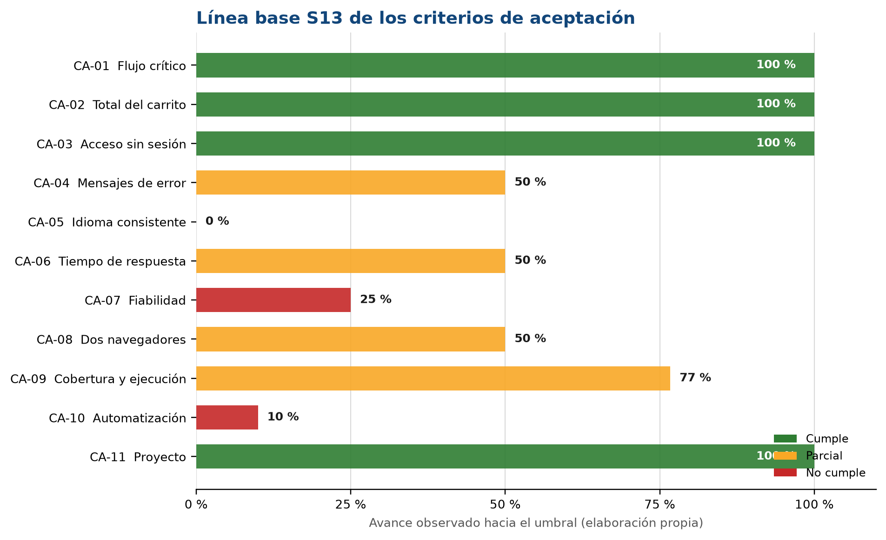
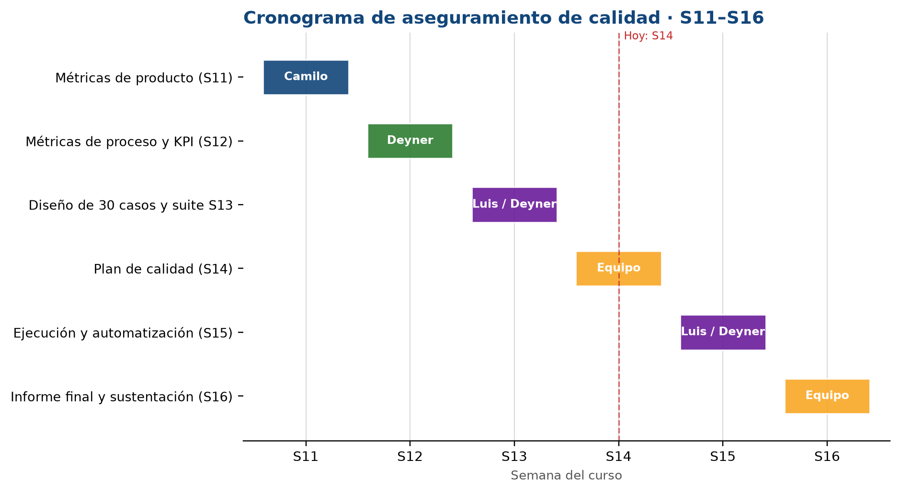

  
UNIVERSIDAD COOPERATIVA DE COLOMBIA

  
Facultad de Ingeniería · Programa Ingeniería de Software

  
Gestión y Calidad del Software · 2026-2

  <h1>Apartado 14</h1>
  <h2>Plan de calidad del software: criterios de aceptación y cronograma</h2>
  
Consolidación del plan para Toolshop: de la intención de calidad a compromisos medibles, con responsables y fechas.

  

  
<strong>Equipo 06</strong>

  
Camilo Vides · Luis Tapia · Deyner Ortiz

  
<strong>Docente:</strong> Andrea Paternina

  
Avance 3 · Semana 14 · Noviembre de 2026

  
Sitio asignado: Toolshop — https://practicesoftwaretesting.com

## Resumen

Este documento es el **plan de calidad** del proyecto sobre Toolshop. No es un apartado teórico ni un informe de resultados: es el documento maestro que une lo que ya construimos en las semanas anteriores y agrega dos cosas que faltaban: **criterios de aceptación medibles** y un **cronograma con responsables**.

Partimos de tres insumos concretos. Del Apartado 8 tomamos el modelo ISO/IEC 25010 y las características que priorizamos. De los Apartados 10, 11 y 12 tomamos las métricas de producto, proceso y proyecto, y el tablero de 10 KPI. Del Apartado 13 tomamos la matriz de 30 casos de prueba, las 6 pruebas ejecutadas y los 7 casos que quedaron pendientes para la Semana 15.

Con eso definimos **11 criterios de aceptación (CA-01 a CA-11)**. Cada criterio tiene una característica, una métrica, un umbral y uno o varios casos de la S13 que lo verifican. No inventamos casos nuevos ni métricas nuevas: ordenamos y conectamos lo que ya teníamos.

La línea base de la S13 deja **4 criterios que cumplen, 4 en estado parcial y 3 que no cumplen**. Los tres que no cumplen son los más exigentes: consistencia idiomática, fiabilidad del carrito/checkout y automatización. Eso no significa que el proyecto esté perdido; significa que el plan ya sabe exactamente dónde apretar en la S15.

Los números que resumen el plan son estos: **30 casos diseñados**, **12 de 12 funciones cubiertas**, **22 casos automatizables y 8 manuales**, **23 de 30 casos ejecutados**, **19 de 23 exitosos** y **3 de 30 automatizados**. Para la S15 la meta es ejecutar los 7 casos pendientes, automatizar 12 casos más y llegar a **15 de 30 = 50 %** de automatización.

El plan también fija el cronograma de las Semanas 11 a 16, los roles de Camilo, Luis y Deyner, la clasificación de severidad de los defectos y los criterios de salida. Con esto pasamos de decir “queremos un sitio de calidad” a decir “esto es lo que tiene que pasar, con qué evidencia, quién lo hace y cuándo”.

## Contenido

1. Introducción y objetivo
2. Alcance y objetivos de calidad
3. Modelo y características priorizadas
4. Métricas del plan
5. Criterios de aceptación
6. Diseño de pruebas y trazabilidad
7. Cronograma de calidad S11–S16
8. Roles y responsabilidades
9. Gestión de defectos y criterios de salida
10. Riesgos y supuestos
11. Conclusiones
Referencias
Anexo A. Ficha detallada de dos criterios
Anexo B. Matriz de trazabilidad
Anexo C. Checklist de salida S15
Anexo D. Glosario

## 1. Introducción y objetivo

Durante el semestre fuimos armando piezas separadas. En la S8 elegimos un modelo de calidad y priorizamos características. En la S10, S11 y S12 definimos métricas y armamos un tablero de KPI. En la S13 diseñamos la suite de 30 casos y ejecutamos las primeras 6 pruebas. Cada pieza tenía sentido por separado, pero faltaba algo que las uniera: un plan que dijera **cuánto hay que alcanzar para aceptar el sitio, quién lo va a hacer y en qué fechas**.

Eso es exactamente el plan de calidad. La IEEE 730 lo describe como el documento que define cómo se asegura y verifica la calidad de un producto: qué se evalúa, con qué criterios, con qué actividades, con qué responsables y en qué momentos (IEEE, 2014). En nuestro caso no es un documento para archivar: es la hoja de ruta de la S15 y la base del informe final de la S16.

El plan se apoya en cuatro insumos:

| Insumo | De dónde sale | Qué aporta al plan |
|---|---|---|
| Modelo y características priorizadas | Apartado 8 (S8) | Define qué características de ISO/IEC 25010 importan y cuáles quedan fuera. |
| Métricas de producto | Apartados 10 y 11 (S10–S11) | Puntos de función, complejidad ciclomática, densidad de defectos y tiempo de carga. |
| Métricas de proceso, proyecto y KPI | Apartado 12 (S12) | Tablero de 10 KPI, metas, umbrales y plan de acción. |
| Matriz de 30 casos y ejecución S13 | Apartado 13 (S13) | Casos, técnicas, suites, evidencias y 7 casos pendientes para S15. |

El objetivo del apartado es consolidar el plan completo. No repetimos la teoría de los apartados anteriores; la usamos. Tampoco reportamos resultados finales: eso será la S15 y la S16. Lo que hacemos aquí es dejar por escrito los compromisos de calidad del equipo.

## 2. Alcance y objetivos de calidad

### 2.1 El sitio y su flujo principal

Toolshop es la tienda de práctica de Practice Software Testing. Es un sitio de demostración con catálogo de herramientas, filtros, ficha de producto, carrito y checkout. El flujo principal que aseguramos es:

**Iniciar sesión → ver catálogo → abrir producto → agregar al carrito → checkout (datos y pago) → confirmación.**

El sitio reporta la versión **v5.0** y la interfaz arranca en español. La cuenta de prueba que usamos es `customer@practicesoftwaretesting.com`, con contraseña `welcome01`. En la S13 confirmamos que el flujo completo funciona y genera factura; la compra exploratoria CP-30 produjo la factura **INV-2026000008** por **$14.15**.

### 2.2 Alcance del aseguramiento

| Dentro del alcance | Fuera del alcance |
|---|---|
| Login, logout, registro y recuperación de contraseña. | Código fuente del sitio y revisión interna de módulos. |
| Catálogo, ordenamiento, filtros por categoría, marca y precio. | Infraestructura del servidor, base de datos y API interna. |
| Ficha de producto, disponibilidad y producto agotado. | Pasarela de pago real y transacciones con dinero. |
| Carrito, cantidades, eliminación y persistencia al recargar. | Pruebas de carga con cientos de usuarios simultáneos. |
| Checkout, validaciones, total y confirmación. | Mantenibilidad interna y compatibilidad con sistemas externos. |
| Usabilidad, mensajes de error, idioma y seguridad de sesión. | Instalabilidad, reemplazabilidad y portabilidad a otros entornos. |
| Eficiencia de desempeño del catálogo y los filtros. | Certificación formal del sitio o auditoría externa. |

La frontera es importante: trabajamos en **caja negra**. No tenemos acceso al código ni al servidor, así que no podemos prometer mantenibilidad ni compatibilidad. Tampoco podemos arreglar el sitio; lo que hacemos es medirlo, probarlo, documentar los defectos y decidir si es aceptable para el uso previsto.

### 2.3 Objetivos de calidad

| Objetivo | Qué buscamos | Indicador o criterio |
|---|---|---|
| OE1. Asegurar el flujo crítico | Que login, catálogo, carrito y checkout funcionen de principio a fin. | CA-01 y CA-02 |
| OE2. Medir con criterios claros | Que cada característica priorizada tenga un umbral verificable. | 11 criterios CA-01 a CA-11 |
| OE3. Completar la ejecución | Ejecutar los 30 casos y cubrir las 12 funciones. | CA-09 |
| OE4. Aumentar la automatización | Pasar de 3 a por lo menos 15 casos automatizados. | CA-10 |
| OE5. Cumplir el cronograma | Entregar a tiempo y con el esfuerzo previsto. | CA-11 |
| OE6. Gestionar los defectos | Clasificar, priorizar y cerrar los defectos con evidencia. | Sección 9 |

## 3. Modelo y características priorizadas

En la S8 elegimos **ISO/IEC 25010** como modelo de calidad. La razón principal es que es el estándar vigente de la familia SQuaRE, se puede aplicar desde la caja negra y separa la calidad del producto de la calidad en uso. McCall y Boehm son modelos históricos valiosos, pero no separan la seguridad como lo hace ISO/IEC 25010; Dromey exige acceso al código, que no tenemos.

De las ocho características del modelo, priorizamos seis. La tabla retoma la priorización de la S8 y agrega cómo la vamos a evaluar en este plan.

| Característica ISO/IEC 25010 | Prioridad | Por qué en Toolshop | Cómo la evaluamos |
|---|---|---|---|
| Usabilidad (capacidad de interacción) | Alta | El catálogo mezcla español con inglés y los filtros conservan etiquetas en inglés; son las fallas más visibles del diagnóstico. | Checklist, CP-09 y CP-13, revisión de mensajes de error. |
| Adecuación funcional | Alta | Es el núcleo transaccional: filtros, carrito, checkout y total. | Casos funcionales y de aceptación, CP-01 a CP-30. |
| Seguridad | Alta | Hay sesión, historial de compras y checkout; no se debe entrar sin autenticación. | CP-04 y CP-05, acceso directo por URL y logout. |
| Fiabilidad | Media | El carrito pierde productos al recargar y hay datos de prueba en el catálogo. | CP-21, CP-23, CP-24 y registro de defectos. |
| Eficiencia de desempeño | Media | El catálogo consume una API y muestra inventario en tiempo real. | Medición con DevTools, CP-06, CP-10 y CP-25. |
| Portabilidad (adaptabilidad) | Media-baja | Puede haber diferencias entre Chrome y Edge. | Casos de humo en dos navegadores, CA-08. |
| Compatibilidad | Baja | No evaluamos integración con otros sistemas. | Fuera del alcance. |
| Mantenibilidad | Baja | Requiere acceso al código fuente, que no tenemos. | Fuera del alcance. |

Las seis características priorizadas se convierten en los 11 criterios de la sección 5. Las dos que dejamos por fuera no se ignoran: se declaran como limitación del alcance para no prometer resultados que no podemos respaldar.

## 4. Métricas del plan

El plan no inventa métricas nuevas. Usa las que ya calculamos y las organiza en las tres dimensiones de la calidad: producto, proceso y proyecto.

### 4.1 Métricas de producto

| Métrica | Fórmula | Valor S13 | Fuente |
|---|---|---|---|
| Puntos de función (PF) | PFNA × VAF | 87,22 | Apartado 11 |
| Complejidad ciclomática del login y checkout | V(G) | 4 en cada flujo | Apartado 11 |
| Densidad de defectos por PF | defectos ÷ PF | 0,080 | KPI-2 |
| % de defectos críticos | críticos ÷ defectos × 100 | 14,3 % | KPI-3 |
| Tiempo de carga del catálogo | medición directa | 2,4 s | KPI-4 |
| % de casos exitosos | exitosos ÷ ejecutados × 100 | 82,6 % (19/23) | KPI-1 |

La densidad de 0,080 defectos por PF se calcula con los 7 defectos del Avance 2 sobre 87,22 PF. Es un valor bajo y está en verde, pero no significa que el sitio sea perfecto: significa que el tamaño del producto y la cantidad de defectos encontrados son manejables. El problema está en la gravedad y en la concentración de los defectos, no en el volumen.

### 4.2 Métricas de proceso

| Métrica | Fórmula | Valor S13 | Lectura |
|---|---|---|---|
| Tasa de ejecución | ejecutados ÷ diseñados × 100 | 76,7 % (23/30) | Bajó porque la matriz creció de 24 a 30 casos. |
| Cobertura funcional | funciones con casos ÷ 12 × 100 | 100 % (12/12) | Ya no hay funciones sin casos. |
| Eficacia de detección (DRE) | E ÷ (E + D) × 100 | 87,5 % | La suite atrapa 7 de cada 8 defectos conocidos. |
| % de automatización | automatizados ÷ diseñados × 100 | 10 % (3/30) | Es el rojo principal del tablero. |

### 4.3 Métricas de proyecto

| Métrica | Fórmula | Valor S13 | Lectura |
|---|---|---|---|
| Cumplimiento del cronograma | hitos a tiempo ÷ hitos programados × 100 | 100 % | Las entregas van al día. |
| Desviación del esfuerzo | valor absoluto de (reales − planeadas) ÷ planeadas × 100 | 8,3 % | Dentro del ±10 % previsto. |
| Distribución de la carga | horas por integrante ÷ horas totales × 100 | 34,6 % / 32,7 % / 32,7 % | El trabajo está equilibrado. |

### 4.4 Tablero de KPI actualizado con la S13

El tablero sigue teniendo 10 KPI. La S13 actualizó cuatro de ellos y dejó el resto igual.

| KPI | Nombre | Meta | Umbral amarillo | Umbral rojo | Valor S13 | Estado | Responsable |
|---|---|---|---|---|---|---|---|
| KPI-1 | % de casos exitosos | ≥ 90 % | 75–89,9 % | < 75 % | 82,6 % | Amarillo | Camilo Vides |
| KPI-2 | Densidad de defectos por PF | ≤ 0,08 | 0,081–0,12 | > 0,12 | 0,080 | Verde | Camilo Vides |
| KPI-3 | % de defectos críticos | ≤ 20 % | 20,1–30 % | > 30 % | 14,3 % | Verde | Camilo Vides |
| KPI-4 | Tiempo de carga del catálogo | ≤ 3 s | 3,1–4 s | > 4 s | 2,4 s | Verde | Luis Tapia |
| KPI-5 | Tasa de ejecución | 100 % | 80–99,9 % | < 80 % | 76,7 % | Rojo | Deyner Ortiz |
| KPI-6 | Cobertura funcional | ≥ 90 % | 75–89,9 % | < 75 % | 100 % | Verde | Deyner Ortiz |
| KPI-7 | Eficacia de detección (DRE) | ≥ 85 % | 70–84,9 % | < 70 % | 87,5 % | Verde | Deyner Ortiz |
| KPI-8 | % de automatización | ≥ 50 % | 30–49,9 % | < 30 % | 10 % | Rojo | Luis Tapia |
| KPI-9 | Cumplimiento del cronograma | 100 % | 80–99,9 % | < 80 % | 100 % | Verde | Camilo Vides |
| KPI-10 | Desviación del esfuerzo | ≤ 10 % | 10,1–20 % | > 20 % | 8,3 % | Verde | Camilo Vides |

El resumen es **7 KPI en verde, 1 en amarillo y 2 en rojo**. Los dos rojos son de proceso, no de producto: la ejecución bajó porque la matriz creció y la automatización sigue muy baja. Eso es justamente lo que el plan debe corregir en la S15.

## 5. Criterios de aceptación

### 5.1 Qué es un criterio de aceptación en este proyecto

Un criterio de aceptación es una condición medible que decide si el sitio pasa o no en una característica de calidad. No es una opinión como “debe ser rápido” o “debe ser fácil de usar”. Tiene que poder responderse con un número o con un sí/no.

Cada criterio de este plan tiene cuatro partes:

1. **Característica:** la característica de ISO/IEC 25010 que se está evaluando.
2. **Métrica:** el valor que se mide y su fórmula.
3. **Umbral:** el límite que separa pasa de falla.
4. **Caso que lo verifica:** el caso de la S13 que produce la evidencia.

Si un criterio no tiene un caso que lo compruebe, sobra. Si un caso no responde a ningún criterio, también sobra. Esa es la regla de trazabilidad que usamos.

### 5.2 Tabla central de criterios

| ID | Característica | Métrica | Umbral de aceptación | Casos que verifican | KPI | Valor S13 | Estado |
|---|---|---|---|---|---|---|---|
| CA-01 | Adecuación funcional | % de casos del flujo crítico que pasan | 100 % de los casos críticos ejecutados | CP-01, CP-05, CP-18, CP-22, CP-30 | KPI-1 | 5/5 = 100 % | Cumple |
| CA-02 | Adecuación funcional | Exactitud del total del carrito | 100 % de los totales verificados | CP-18, CP-19, CP-30 | KPI-1 / KPI-2 | 3/3 = 100 % | Cumple |
| CA-03 | Seguridad | Bloqueo de acceso sin sesión | 100 % de los accesos sin sesión | CP-04, CP-05 | KPI-3 | 2/2 = 100 % | Cumple |
| CA-04 | Usabilidad | Claridad de mensajes de error | 100 % de los campos inválidos | CP-03, CP-23, CP-27 | KPI-1 | 1/2 = 50 % | Parcial |
| CA-05 | Usabilidad | Consistencia idiomática | 100 % de mensajes de error y etiquetas de formulario | CP-09, CP-13 | KPI-1 | 0/2 = 0 % | No cumple |
| CA-06 | Eficiencia de desempeño | Tiempo de catálogo y filtro | ≤ 3 s para catálogo y filtro | CP-06, CP-10, CP-25 | KPI-4 | Catálogo 2,4 s; filtro pendiente | Parcial |
| CA-07 | Fiabilidad | Defectos críticos abiertos y densidad | 0 críticos abiertos; ≤ 1 mayor documentado; densidad ≤ 0,08 por PF | CP-21, CP-23, CP-24, CP-30 | KPI-2 / KPI-3 | 1 crítico (D-06); 0,080 def./PF | No cumple |
| CA-08 | Portabilidad (adaptabilidad) | Casos de humo en dos navegadores | 100 % en Chrome y Edge, escritorio y móvil | CP-01, CP-18, CP-30 | KPI-1 / KPI-6 | Chrome 3/3; Edge pendiente | Parcial |
| CA-09 | Proceso · cobertura y ejecución | Funciones y casos ejecutados | 12/12 funciones y 30/30 casos ejecutados | CP-01 a CP-30 | KPI-5 / KPI-6 | 12/12 diseño; 23/30 ejecución | Parcial |
| CA-10 | Proceso · automatización | % de casos automatizados | ≥ 50 % (15/30) al cierre de S15 | CP-01 a CP-30 | KPI-8 | 3/30 = 10 % | No cumple |
| CA-11 | Proyecto · cronograma y esfuerzo | Hitos a tiempo y desviación de horas | 100 % de hitos y desviación ≤ 10 % | Actividades S11–S16 | KPI-9 / KPI-10 | 100 % y 8,3 % | Cumple |

**Cómo se lee la tabla.** “Cumple” significa que en la S13 el criterio ya se alcanzó con la evidencia disponible. “Parcial” significa que hay una parte verificada y otra pendiente de S15. “No cumple” significa que el valor observado está por debajo del umbral y necesita una acción concreta. La línea base es **4 cumple, 4 parciales y 3 no cumple**.

Figura 1. Línea base S13 de los 11 criterios de aceptación (elaboración propia).

### 5.3 Criterios de producto (CA-01 a CA-08)

**CA-01. Flujo crítico.** Es el criterio más importante. Si el cliente no puede iniciar sesión, agregar un producto al carrito y completar la compra, el sitio no sirve para lo que fue creado. Los cinco casos críticos son CP-01 (login válido), CP-05 (logout), CP-18 (agregar al carrito), CP-22 (iniciar checkout) y CP-30 (compra completa). Los cinco tienen evidencia: CP-01, CP-05, CP-18 y CP-30 pasaron en la S13; CP-22 pasó en el Avance 2. Por eso el criterio está en verde. En la S15 se vuelven a ejecutar como suite de humo.

**CA-02. Total del carrito.** No basta con que la compra “termine”: el total tiene que ser coherente. En CP-30 verificamos una unidad de Combination Pliers y el sitio mostró **$14.15**, que coincide con el precio del producto más el impuesto. En CP-18 verificamos el contador del carrito y en CP-19 la cantidad. El criterio exige que el total mostrado sea siempre la suma de los ítems más el impuesto.

**CA-03. Acceso sin sesión.** Un sitio con historial y checkout no puede permitir que alguien entre a `/account` o `/checkout` sin autenticarse. CP-04 intenta abrir esas rutas por URL y CP-05 cierra sesión y prueba el botón Atrás. CP-04 pasó en el Avance 2 y CP-05 pasó en la S13, así que el criterio está en verde.

**CA-04. Mensajes de error.** Cuando el usuario deja un campo obligatorio vacío o escribe un correo inválido, el sitio debe mostrar un mensaje claro y visible. CP-03 pasó en el Avance 2, pero CP-23 (checkout con campos vacíos) falló y CP-27 (registro con correo existente) está pendiente. Por eso el criterio queda en **50 %**.

**CA-05. Consistencia idiomática.** La interfaz arranca en español, pero el catálogo y los filtros mezclan inglés y español. CP-09 falló porque aparecen categorías como `Hand Tools` y `Power Tools`, y el mensaje de credenciales inválidas dice `Invalid email or password`. CP-13 falló porque las etiquetas de los filtros siguen en inglés. El criterio exige que los mensajes de error y las etiquetas de formulario estén en el idioma seleccionado; los nombres de categorías y marcas se aceptan como nombres propios, pero se documentan como excepción.

**CA-06. Tiempo de respuesta.** El catálogo cargó en **2,4 s** en la medición de la S12, por debajo del umbral de 3 s. El tiempo del filtro todavía no está medido con rigor; por eso el criterio es parcial. En la S15 se mide con DevTools al aplicar CP-10 y CP-25.

**CA-07. Fiabilidad.** Este criterio tiene dos partes. La primera es que no haya defectos críticos abiertos al cierre. Hoy D-06 (el carrito pierde los productos al recargar) sigue pendiente de repetir y se considera crítico. La segunda es que la densidad de defectos por PF no supere 0,08; hoy está justo en 0,080, en el límite. Por eso el criterio no cumple: hay un crítico abierto y no hay margen en la densidad.

**CA-08. Dos navegadores.** La S13 se ejecutó en Chrome. Para aceptar el criterio hay que repetir los tres casos de humo (CP-01, CP-18 y CP-30) en Edge, en escritorio y en una resolución móvil. Si Edge no está disponible, se documenta como limitación y se usa el modo responsive de Chrome, pero no se declara cumplido sin evidencia.

### 5.4 Criterios de proceso y proyecto (CA-09 a CA-11)

**CA-09. Cobertura y ejecución.** La cobertura de diseño ya está en **12 de 12 funciones = 100 %**. Lo que falta es ejecutar los 7 casos pendientes para llegar a **30 de 30 = 100 %**. Hoy vamos en 23 de 30 = 76,7 %. Este criterio es de proceso: no dice si el sitio es bueno, dice si nosotros terminamos el trabajo.

**CA-10. Automatización.** Hoy hay 3 casos automatizados de 30 = **10 %**. La meta es llegar a **15 de 30 = 50 %** en la S15. Los 12 candidatos son CP-03, CP-04, CP-08, CP-10, CP-11, CP-12, CP-14, CP-17, CP-19, CP-20, CP-22 y CP-25. Si el tiempo no alcanza, se priorizan los casos de login, carrito y checkout, y se documenta qué quedó manual y por qué.

**CA-11. Proyecto.** El cronograma va al día y la desviación del esfuerzo es 8,3 %, dentro del ±10 %. El criterio se cumple en la línea base, pero se sigue midiendo cada semana. Si la S15 se corre más de una semana o el esfuerzo se desvía más de 10 %, se activa el plan de contingencia de la sección 10.

### 5.5 Ficha detallada de un criterio

Para que el criterio no quede en una frase suelta, cada uno tiene una ficha como la de CA-01. La ficha completa de CA-01 y CA-10 está en el Anexo A. La estructura es: característica, métrica, fórmula, umbral, casos, evidencia, línea base, responsable, meta S15 y qué pasa si falla.

## 6. Diseño de pruebas y trazabilidad

### 6.1 De dónde salen los casos

El plan no diseña casos nuevos. Usa la matriz de **30 casos** de la S13, que a su vez conserva los 24 del Avance 2 y agrega 6: CP-25 (filtro y paginación), CP-26 (registro válido), CP-27 (correo existente), CP-28 (recuperación), CP-29 (checkout con dirección de 1 carácter) y CP-30 (compra completa).

La matriz cubre **12 funciones**:

| Función | Casos principales | Automatización |
|---|---|---|
| F1. Iniciar sesión | CP-01, CP-02, CP-03, CP-04 | 4 automatizados |
| F2. Cerrar sesión | CP-05 | 1 manual |
| F3. Registro de usuario | CP-26, CP-27 | 2 automatizados |
| F4. Recuperación de contraseña | CP-28 | 1 automatizado |
| F5. Listado de catálogo | CP-06, CP-07, CP-09 | 1 automatizado, 2 manuales |
| F6. Ordenamiento | CP-08 | 1 automatizado |
| F7. Filtro por categoría | CP-10, CP-14, CP-25 | 3 automatizados |
| F8. Filtro por marca | CP-11, CP-13 | 1 automatizado, 1 manual |
| F9. Filtro por precio | CP-12 | 1 automatizado |
| F10. Ficha de producto | CP-15, CP-16, CP-17 | 2 automatizados, 1 manual |
| F11. Carrito | CP-18, CP-19, CP-20, CP-21 | 3 automatizados, 1 manual |
| F12. Checkout | CP-22, CP-23, CP-24, CP-29, CP-30 | 3 automatizados, 2 manuales |

La tabla asigna cada caso a su **función principal** para que la suma sea 30. CP-13, CP-17, CP-25 y CP-30 también tocan otras funciones; por eso la matriz completa tiene **35 vínculos función–caso**. De los 30 casos únicos, **22 son automatizables y 8 permanecen manuales** porque dependen de juicio humano: CP-05, CP-07, CP-09, CP-13, CP-16, CP-21, CP-23 y CP-24.

### 6.2 Suite ejecutada en S13

La S13 ejecutó 6 pruebas de la suite: 3 manuales y 3 automatizadas. El resultado fue **4 aprobadas y 2 fallidas**. Además, hicimos una compra exploratoria CP-30 que no cuenta dentro de las 6.

| Suite | Casos | Tipo | Resultado |
|---|---|---|---|
| Login automatizado | CP-01, CP-02 | Automatizada | 2/2 pasa |
| Carrito automatizado | CP-18 | Automatizada | Pasa |
| Seguridad y logout | CP-05 | Manual | Pasa |
| Idioma del catálogo | CP-09 | Manual | Falla (D-02) |
| Filtros y metadatos | CP-13 | Manual | Falla (D-04) |
| Compra completa exploratoria (fuera de las 6) | CP-30 | Manual exploratoria | Pasa; factura INV-2026000008 por $14.15 |

Las 6 de la suite son CP-01, CP-02, CP-18, CP-05, CP-09 y CP-13; CP-30 es evidencia adicional para CA-01 y CA-02.

La suite automatizada se implementó con **Java 21, Gradle 8.10.2, Serenity BDD 4.2.34, Screenplay, JUnit 5, Selenium 4 y Chrome headless**. Los tres tests automatizados pasaron en 16,039 s: CP-01 en 3,227 s, CP-02 en 7,867 s y CP-18 en 4,945 s. El reporte de Gradle y las capturas están en la carpeta de evidencias de la S13.

### 6.3 Casos pendientes para S15

| Caso | Qué verifica | Prioridad | Responsable |
|---|---|---|---|
| CP-14 | Combinar categoría, marca y precio | Alta | Luis Tapia |
| CP-24 | Checkout con producto agotado | Alta | Deyner Ortiz |
| CP-25 | Filtrar y recorrer toda la paginación | Alta | Luis Tapia |
| CP-26 | Registro con correo nuevo | Alta | Luis Tapia |
| CP-27 | Registro con correo existente | Media | Deyner Ortiz |
| CP-28 | Recuperación de contraseña | Alta | Luis Tapia |
| CP-29 | Checkout con dirección de 1 carácter | Baja | Deyner Ortiz |

### 6.4 Automatización prevista para S15

Para llegar al 50 % hay que automatizar 12 casos más. La selección prioriza los que ya tienen un resultado esperado comprobable por el programa y los que más se repiten en cada ronda:

**CP-03, CP-04, CP-08, CP-10, CP-11, CP-12, CP-14, CP-17, CP-19, CP-20, CP-22 y CP-25.**

Con los 3 que ya existen, el total sería **15 de 30 = 50 %**. Si alguno no se alcanza, se reemplaza por otro de la misma familia y se deja la justificación en el informe de S15.

### 6.5 Trazabilidad

Cada criterio tiene al menos un caso y cada caso responde a una función. La matriz completa está en el Anexo B y en el Excel del plan. La idea es simple: si alguien pregunta “¿dónde se prueba CA-05?”, la respuesta es CP-09 y CP-13; si pregunta “¿para qué sirve CP-25?”, la respuesta es CA-06 y CA-09. No hay criterios huérfanos ni casos sueltos.

## 7. Cronograma de calidad S11–S16

El cronograma de calidad no es el cronograma de desarrollo del sitio: el sitio ya existe. Es el calendario de **nuestro trabajo de aseguramiento**: medir, diseñar, ejecutar, analizar y reportar. Cada semana tiene una actividad, un responsable y un entregable.

| Semana | Fechas | Actividad de calidad | Responsable | Entregable / hito | Estado |
|---|---|---|---|---|---|
| 11 | 19–25 oct 2026 | Calcular métricas de producto: PF, V(G), densidad y tiempo de carga. | Camilo Vides | Tabla de métricas de producto S11 | Cumplido |
| 12 | 26 oct–1 nov 2026 | Definir métricas de proceso/proyecto y armar el tablero de 10 KPI. | Deyner Ortiz | Tablero de KPI S12 y plan de acción | Cumplido |
| 13 | 2–8 nov 2026 | Diseñar la suite de 30 casos y ejecutar 6 pruebas (3 manuales y 3 automatizadas). | Luis Tapia (diseño) · Deyner Ortiz (manual) · Camilo Vides (automatización) | Matriz de 30 casos y 6 evidencias | Cumplido |
| 14 | 9–15 nov 2026 | Consolidar el plan de calidad: criterios, cronograma, roles y gestión de defectos. | Camilo Vides · Luis Tapia · Deyner Ortiz | Plan de calidad S14 (este documento) | En curso |
| 15 | 16–22 nov 2026 | Ejecutar los 7 casos pendientes, automatizar 12 casos, repetir defectos y actualizar KPI. | Luis Tapia (automatización) · Deyner Ortiz (manual) · Camilo Vides (métricas) | 30/30 casos, evidencias y tablero actualizado | Pendiente |
| 16 | 23–29 nov 2026 | Redactar el informe final y preparar la sustentación de 10–12 minutos. | Camilo Vides · Luis Tapia · Deyner Ortiz | Informe final PDF (APA) y sustentación | Pendiente |

Figura 2. Cronograma de aseguramiento de calidad de la S11 a la S16 (elaboración propia).

### 7.1 Hitos y dependencias

Los hitos son cuatro:

1. **S13:** matriz de 30 casos y primera ejecución. Es el insumo directo de este plan.
2. **S14:** plan de calidad aprobado. Es el insumo directo de la S15.
3. **S15:** ejecución completa, automatización y tablero actualizado. Es el insumo directo de la S16.
4. **S16:** informe final y sustentación.

La ruta crítica es **S13 → S15 → S16**. La S14 no produce ejecución, pero sin ella la S15 no tendría criterios ni prioridades. La automatización corre en paralelo con la ejecución manual; si se retrasa, no bloquea las pruebas manuales, pero sí afecta el KPI-8.

### 7.2 Holgura y contingencias del cronograma

Reservamos un **10 % del tiempo de la S15** para repetir defectos y atender imprevistos. Si la automatización se retrasa, el orden de prioridad es: primero los casos de login, carrito y checkout (CP-01, CP-02, CP-18, CP-22 y CP-30), después los filtros y el registro. Los casos manuales CP-09 y CP-13 no se automatizan en esta etapa porque dependen de juicio humano sobre el idioma y la legibilidad.

## 8. Roles y responsabilidades

El equipo tiene tres integrantes. Cada uno asume un rol principal, pero todos participan en la ejecución y en la sustentación.

| Rol | Integrante | Responsabilidad principal | Entregables |
|---|---|---|---|
| Líder de calidad (QA Lead) y analista de métricas | Camilo Vides | Coordina el plan, verifica la trazabilidad criterio–caso–evidencia, calcula los KPI de producto y consolida el informe final. | Plan S14, tablero de KPI, informe S16 |
| Diseñador de pruebas y automatizador | Luis Tapia | Mantiene la matriz de 30 casos, implementa la suite Screenplay y ejecuta las pruebas automatizadas. | Matriz S13, suite Java/Gradle, reporte Gradle |
| Tester manual y gestor de defectos | Deyner Ortiz | Ejecuta pruebas manuales, registra evidencias, clasifica defectos y controla el cronograma y las horas. | Evidencias manuales, registro D-01 a D-08, control de horas |

### 8.1 Matriz RACI

R = responsable de hacer, A = aprueba, C = consultado, I = informado.

| Actividad | Camilo Vides | Luis Tapia | Deyner Ortiz |
|---|---|---|---|
| Plan de calidad | A/R | C | C |
| Matriz de 30 casos | C | A/R | C |
| Automatización Screenplay | C | A/R | I |
| Ejecución manual | I | C | A/R |
| Métricas y KPI | A/R | C | C |
| Registro de defectos | C | I | A/R |
| Informe final | A/R | C | C |
| Sustentación | R | R | R |

### 8.2 Distribución de la carga

La S12 registró una distribución de **34,6 % / 32,7 % / 32,7 %** sobre 52 horas. El plan mantiene ese equilibrio: Camilo concentra la coordinación y las métricas, Luis la automatización y el diseño, y Deyner la ejecución manual y el control de defectos. Ninguna actividad queda sin dueño.

## 9. Gestión de defectos y criterios de salida

### 9.1 Clasificación de severidad

| Severidad | Definición | Ejemplos en Toolshop | Criterio de cierre |
|---|---|---|---|
| Crítica | Impide completar el flujo principal, pierde datos o permite un acceso no autorizado. | D-01 (botón Atrás después del logout), D-06 (el carrito pierde los productos). | 0 abiertas para aprobar. |
| Mayor | Falla importante con una solución alterna; el usuario puede continuar, pero con esfuerzo o riesgo. | D-07 (checkout con dirección vacía), D-08 (filtro y paginación). | ≤ 1 abierta, documentada y con plan de acción. |
| Menor | Defecto cosmético, de idioma o de metadatos que no impide usar el sitio. | D-02 (idioma mezclado), D-03 (marcas de prueba), D-04 (etiquetas en inglés), D-05 (contador). | Se documentan; no bloquean la aceptación. |

### 9.2 Ciclo de vida de un defecto

1. **Detección:** el caso falla y se registra la evidencia (captura, reporte, URL, fecha).
2. **Registro:** se asigna un ID (D-01, D-02…) y se indica el caso de origen.
3. **Clasificación:** se asigna severidad según la tabla anterior.
4. **Asignación:** se define el responsable y la semana de corrección o reintento.
5. **Repetición:** en la S15 se vuelve a ejecutar el caso en una ventana limpia.
6. **Cierre:** si no se reproduce, se cierra con la evidencia; si persiste, se mantiene abierto y se actualiza el tablero.

### 9.3 Estado de los defectos en S13

| ID | Módulo | Descripción | Severidad | Estado S13 | Acción para S15 |
|---|---|---|---|---|---|
| D-01 | Autenticación | El botón Atrás devuelve a la cuenta con datos en caché. | Crítica | No reproducido | Repetir en ventana de incógnito y cerrar si no aparece. |
| D-02 | Catálogo | La vista mezcla etiquetas en español con categorías y estados en inglés. | Menor | Persiste | Documentar como excepción de localización; no bloquea la compra. |
| D-03 | Filtros | La lista de marcas incluye registros de prueba «some name». | Menor | No reproducido | Repetir con CP-13 y cerrar si no aparece. |
| D-04 | Filtros | Las etiquetas del panel de filtros permanecen en inglés. | Menor | Persiste | Documentar y priorizar para una corrección de usabilidad. |
| D-05 | Filtros | El contador de resultados no se actualiza al limpiar el filtro. | Menor | No observable | Instrumentar el contador o declarar el defecto no observable. |
| D-06 | Carrito | El contenido del carrito se pierde al recargar la página. | Crítica | Pendiente de repetir | Ejecutar CP-21; si persiste, bloquea la aceptación. |
| D-07 | Checkout | El formulario permite avanzar con la dirección vacía y el error aparece al final. | Mayor | Pendiente de repetir | Ejecutar CP-23; debe corregirse antes de aceptar el checkout. |
| D-08 | Filtros y paginación | Al filtrar y pasar a la página 2, el filtro se pierde y aparecen productos de otras categorías. | Mayor | Pendiente de ejecutar | Ejecutar CP-25; si persiste, se documenta como defecto mayor. |

Lo más valioso de la S13 es que **D-01 y D-03 no se reprodujeron**. Eso no significa que hayan desaparecido para siempre; significa que en la versión actual no los vemos. En la S15 se repiten antes de cerrarlos. D-02 y D-04 siguen abiertos y son la razón de las dos fallas manuales. D-06 y D-07 son los que más pueden afectar la aceptación porque tocan carrito y checkout.

### 9.4 Criterios de salida

La prueba se cierra con uno de estos tres dictámenes:

| Dictamen | Condición | Qué se reporta |
|---|---|---|
| Aceptado | Pasan los 11 criterios; 0 defectos críticos y 0 mayores abiertos. | Informe final con evidencia completa. |
| Aceptado con observaciones | Pasan CA-01, CA-02, CA-03 y CA-07; 0 críticos; ≤ 1 mayor documentado; las demás pueden quedar como observación con plan de acción. | Informe final con la lista de observaciones y responsables. |
| Rechazado | Falla CA-01, CA-02, CA-03 o CA-07; hay un crítico abierto; o hay más de 1 mayor abierto. | Informe con el motivo, la evidencia y la recomendación de no aceptar. |

El criterio de salida no es “0 defectos de cualquier tipo”: eso sería irreal para un sitio de terceros. Lo que sí exigimos es que **ningún defecto crítico quede abierto** y que los defectos mayores estén documentados con un plan de acción. Los menores se aceptan y se reportan.

## 10. Riesgos y supuestos

### 10.1 Riesgos del plan

| Riesgo | Probabilidad | Impacto | Mitigación | Responsable |
|---|---|---|---|---|
| El sitio cambia de versión durante la S15. | Media | Alto | Congelar la versión observada, guardar capturas y repetir la suite de humo antes de ejecutar. | Camilo Vides |
| La automatización no llega al 50 %. | Alta | Alto | Priorizar login, carrito y checkout; dejar los filtros para el final; documentar qué quedó manual. | Luis Tapia |
| Diferencias entre Chrome y Edge. | Media | Medio | Ejecutar los tres casos de humo en ambos navegadores y en modo responsive. | Luis Tapia |
| El tiempo del equipo se reduce por otras entregas. | Media | Alto | Revisión semanal, RACI y holgura del 10 % en S15. | Camilo Vides |
| Aparece un defecto crítico nuevo. | Baja | Alto | Detener la aceptación, documentar, repetir y reportar en el informe final. | Deyner Ortiz |
| Falsos positivos en los reportes de defectos. | Media | Medio | Revisión doble y evidencia reproducible antes de declarar un defecto. | Deyner Ortiz |
| Los datos de la S15 no alcanzan para cerrar todos los KPI. | Alta | Medio | Usar la línea base S13, priorizar los KPI rojos y reportar la tendencia con transparencia. | Camilo Vides |

### 10.2 Supuestos

- El sitio se mantiene estable en la versión observada durante la S15.
- La cuenta de prueba sigue activa y permite iniciar sesión.
- Chrome y Edge están disponibles en los equipos del equipo.
- Cada integrante dispone de 10 a 12 horas por semana para el proyecto.
- No habrá acceso al código fuente ni al servidor; seguimos en caja negra.
- Los 7 casos pendientes se pueden ejecutar con la misma cuenta y los mismos datos de prueba.

### 10.3 Plan de contingencia

Si la automatización no llega al 50 %, el mínimo aceptable es **9 de 30 = 30 %**, que es el umbral amarillo del KPI-8. Si ni siquiera se llega a 9, el plan de calidad se acepta con observaciones, pero el informe final debe explicar qué se intentó, qué falló y qué se deja para una siguiente ronda. Si aparece un defecto crítico, no se declara “aceptado” ni “aceptado con observaciones”: se rechaza y se reporta con la evidencia, salvo que el defecto se corrija y se vuelva a probar antes del cierre.

## 11. Conclusiones

El plan de calidad cierra la brecha entre lo que ya sabíamos medir y lo que faltaba decidir. Tenemos **11 criterios medibles**, cada uno con su característica, su métrica, su umbral y sus casos. Tenemos un cronograma de la S11 a la S16 con responsables y entregables. Tenemos roles, una matriz RACI, una clasificación de severidad y criterios de salida.

La línea base de la S13 es honesta: **4 criterios cumplen, 4 están parciales y 3 no cumplen**. Los que no cumplen son los que más importan para la S15: el idioma, la fiabilidad del carrito/checkout y la automatización. No prometemos que todo quedará en verde; prometemos que cada decisión quedará documentada con evidencia.

El plan también deja claro qué **no** vamos a hacer: no vamos a evaluar mantenibilidad ni compatibilidad, no vamos a arreglar el sitio y no vamos a inventar casos para maquillar la cobertura. Lo que sí vamos a hacer es ejecutar los 7 casos pendientes, automatizar 12 más, repetir los defectos D-01, D-03, D-06 y D-07, y actualizar el tablero con los datos reales.

Con esto, la S15 tiene una hoja de ruta y la S16 tiene una base para el informe final y la sustentación. El plan convierte la intención de calidad en compromisos verificables.

## Referencias

Doran, G. T. (1981). There's a S.M.A.R.T. way to write management's goals and objectives. *Management Review, 70*(11), 35–36.

Equipo 06. (2026). *GCS_Equipo06_Apartado12_Metricas_de_proceso_y_KPI_Toolshop* [Documento de curso]. Universidad Cooperativa de Colombia.

Equipo 06. (2026). *GCS_Equipo06_Apartado13_Pruebas_niveles_tipos_y_tecnicas_Toolshop* [Documento de curso]. Universidad Cooperativa de Colombia.

IEEE. (2014). *IEEE 730-2014 — IEEE Standard for Software Quality Assurance Processes*. IEEE.

ISO/IEC. (2011). *ISO/IEC 25010:2011 — Systems and software engineering — Systems and software Quality Requirements and Evaluation (SQuaRE) — System and software quality models*. ISO.

ISO/IEC. (2014). *ISO/IEC 25000:2014 — Systems and software engineering — SQuaRE — Guide to SQuaRE*. ISO.

ISO/IEC. (2016). *ISO/IEC 25023:2016 — Systems and software engineering — Systems and software Quality Requirements and Evaluation (SQuaRE) — Measurement of system and software product quality*. ISO.

ISO/IEC/IEEE. (2017). *ISO/IEC/IEEE 15939:2017 — Systems and software engineering — Measurement process*. ISO/IEC/IEEE.

ISO/IEC/IEEE. (2017). *ISO/IEC/IEEE 29119 — Software and systems engineering — Software testing*. ISO/IEC/IEEE.

ISTQB. (2023). *Certified Tester Foundation Level (CTFL) syllabus v4.0*. International Software Testing Qualifications Board. https://www.istqb.org/

Jones, C. (2008). *Applied software measurement: Global analysis of productivity and quality* (3rd ed.). McGraw-Hill.

Kan, S. H. (2002). *Metrics and models in software quality engineering* (2nd ed.). Addison-Wesley.

Parmenter, D. (2015). *Key performance indicators: Developing, implementing, and using winning KPIs* (3rd ed.). Wiley.

Pressman, R. S., & Maxim, B. R. (2020). *Software engineering: A practitioner's approach* (9th ed.). McGraw-Hill.

Project Management Institute. (2021). *A guide to the project management body of knowledge (PMBOK Guide)* (7th ed.). PMI.

Practice Software Testing. (s. f.). *Toolshop*. https://practicesoftwaretesting.com

## Anexo A. Ficha detallada de dos criterios

### A.1 Ficha de CA-01

| Campo | CA-01 · Flujo crítico |
|---|---|
| Característica | Adecuación funcional |
| Métrica | % de casos del flujo crítico que pasan |
| Fórmula | casos críticos exitosos ÷ casos críticos ejecutados × 100 |
| Umbral | 100 % de los casos críticos ejecutados |
| Casos que lo verifican | CP-01, CP-05, CP-18, CP-22 y CP-30 |
| Evidencia | Reporte Gradle de CP-01 y CP-18, captura de CP-05, factura de CP-30 |
| Línea base S13 | 5/5 = 100 % (cumple) |
| Responsable | Camilo Vides |
| Meta S15 | Mantener 5/5 y repetir la suite de humo en Chrome y Edge |
| Si falla | Se detiene la aceptación y se reporta como defecto crítico |

### A.2 Ficha de CA-10

| Campo | CA-10 · Automatización |
|---|---|
| Característica | Proceso · automatización |
| Métrica | % de casos con script automatizado |
| Fórmula | casos automatizados ÷ casos diseñados × 100 |
| Umbral | ≥ 50 % (15/30) al cierre de S15 |
| Casos que lo verifican | CP-01 a CP-30 |
| Evidencia | Suite Screenplay, reporte Gradle y capturas de ejecución |
| Línea base S13 | 3/30 = 10 % (no cumple) |
| Responsable | Luis Tapia |
| Meta S15 | 15/30 = 50 % |
| Si falla | Se acepta con observaciones si se llega al menos a 9/30 = 30 % y se documenta qué quedó manual |

## Anexo B. Matriz de trazabilidad

| Característica ISO/IEC 25010 | KPI | Criterio | Casos que lo evidencian |
|---|---|---|---|
| Adecuación funcional | KPI-1 | CA-01, CA-02 | CP-01, CP-05, CP-18, CP-19, CP-22, CP-30 |
| Seguridad | KPI-3 | CA-03 | CP-04, CP-05 |
| Usabilidad | KPI-1 | CA-04, CA-05 | CP-03, CP-09, CP-13, CP-23, CP-27 |
| Eficiencia de desempeño | KPI-4 | CA-06 | CP-06, CP-10, CP-25 |
| Fiabilidad | KPI-2, KPI-3 | CA-07 | CP-21, CP-23, CP-24, CP-30 |
| Portabilidad (adaptabilidad) | KPI-1, KPI-6 | CA-08 | CP-01, CP-18, CP-30 |
| Proceso · cobertura y ejecución | KPI-5, KPI-6 | CA-09 | CP-01 a CP-30 |
| Proceso · automatización | KPI-8 | CA-10 | CP-01 a CP-30 |
| Proyecto · cronograma y esfuerzo | KPI-9, KPI-10 | CA-11 | Actividades S11–S16 |

**Nota.** Hay 30 casos únicos y 35 vínculos función–caso porque CP-13, CP-17, CP-25 y CP-30 cubren más de una función. La matriz completa, con técnica, nivel, tipo, prioridad y resultado, está en el Excel del Apartado 13.

## Anexo C. Checklist de salida S15

| # | Verificación | Evidencia | Responsable | Estado |
|---|---|---|---|---|
| 1 | CA-01: los 5 casos críticos pasan. | Reporte Gradle y capturas. | Camilo Vides | Pendiente |
| 2 | CA-02: el total del carrito es correcto. | Captura de CP-18 y factura de CP-30. | Camilo Vides | Pendiente |
| 3 | CA-03: no se entra sin sesión. | Captura de CP-04 y CP-05. | Luis Tapia | Pendiente |
| 4 | CA-04: los campos inválidos muestran mensaje. | Captura de CP-03, CP-23 y CP-27. | Deyner Ortiz | Pendiente |
| 5 | CA-05: los mensajes y etiquetas están en el idioma seleccionado. | Captura de CP-09 y CP-13. | Deyner Ortiz | Pendiente |
| 6 | CA-06: catálogo y filtro cargan en ≤ 3 s. | Captura de DevTools. | Luis Tapia | Pendiente |
| 7 | CA-07: no hay críticos abiertos y la densidad es ≤ 0,08. | Registro de defectos y tablero. | Camilo Vides | Pendiente |
| 8 | CA-08: los 3 casos de humo pasan en Chrome y Edge. | Capturas de ambos navegadores. | Luis Tapia | Pendiente |
| 9 | CA-09: 12/12 funciones y 30/30 casos ejecutados. | Matriz y registro de ejecución. | Deyner Ortiz | Pendiente |
| 10 | CA-10: al menos 15/30 casos automatizados. | Suite Screenplay y reporte Gradle. | Luis Tapia | Pendiente |
| 11 | CA-11: hitos a tiempo y desviación ≤ 10 %. | Registro de horas y entregas. | Camilo Vides | Pendiente |

## Anexo D. Glosario

**Plan de calidad (SQA Plan):** documento que describe cómo se asegura y verifica la calidad: qué se evalúa, con qué criterios, con qué actividades, quién es responsable y en qué fechas.

**Criterio de aceptación:** condición medible con un umbral que decide si el sitio pasa o falla en una característica de calidad.

**Umbral:** valor límite que separa el pasa del falla (por ejemplo, ≤ 3 s o ≥ 50 %).

**Cronograma de calidad:** calendario de las actividades de aseguramiento, con responsables y entregables.

**Hito:** punto de control importante del cronograma, como “matriz de 30 casos” o “pruebas ejecutadas”.

**Severidad:** qué tan grave es el impacto de un defecto (crítica, mayor o menor).

**Criterio de salida:** condición que define cuándo la prueba termina con éxito y con qué dictamen.

**Trazabilidad:** posibilidad de seguir el hilo característica → métrica → criterio → caso → evidencia.

**RACI:** matriz que distingue quién hace (R), quién aprueba (A), quién es consultado (C) y quién es informado (I).

**KPI:** indicador clave que se compara contra una meta para tomar decisiones.

**DRE (Defect Removal Efficiency):** porcentaje de defectos que la suite detecta antes de que lleguen al usuario; se calcula como E ÷ (E + D) × 100.

**V(G):** complejidad ciclomática; cuenta los caminos independientes de un flujo. En Toolshop el login y el checkout tienen V(G) = 4.
